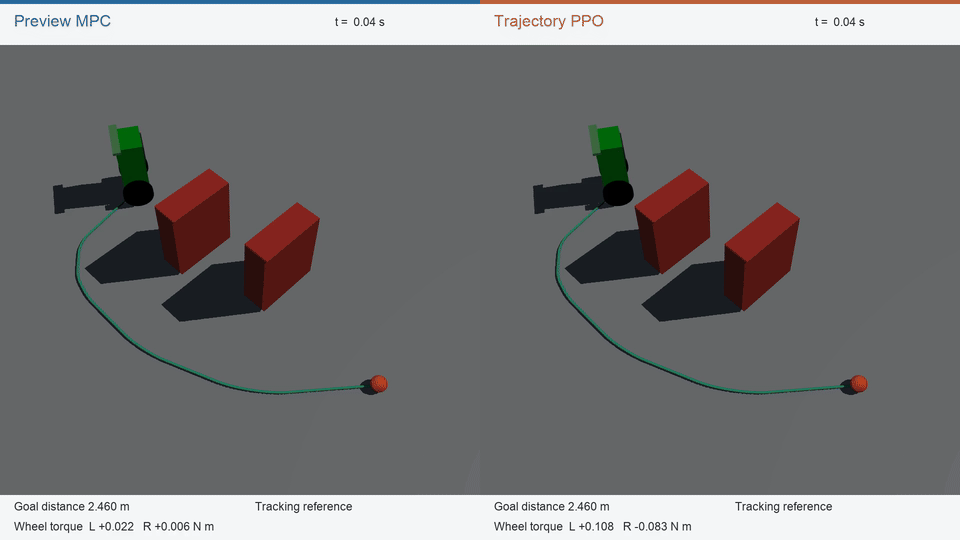
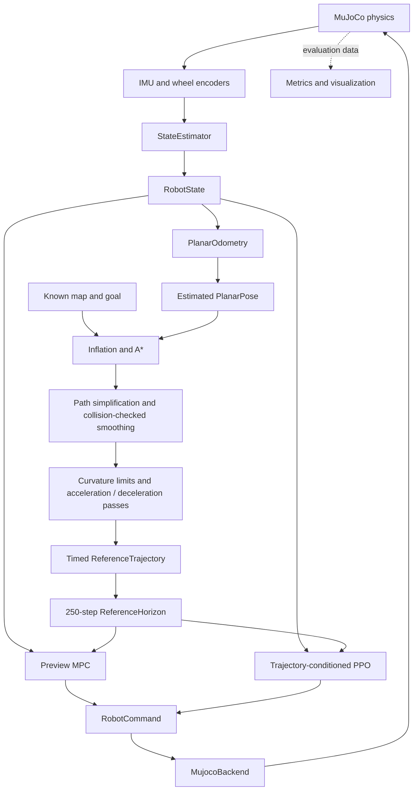
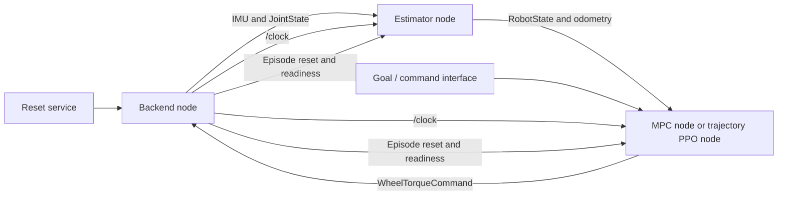
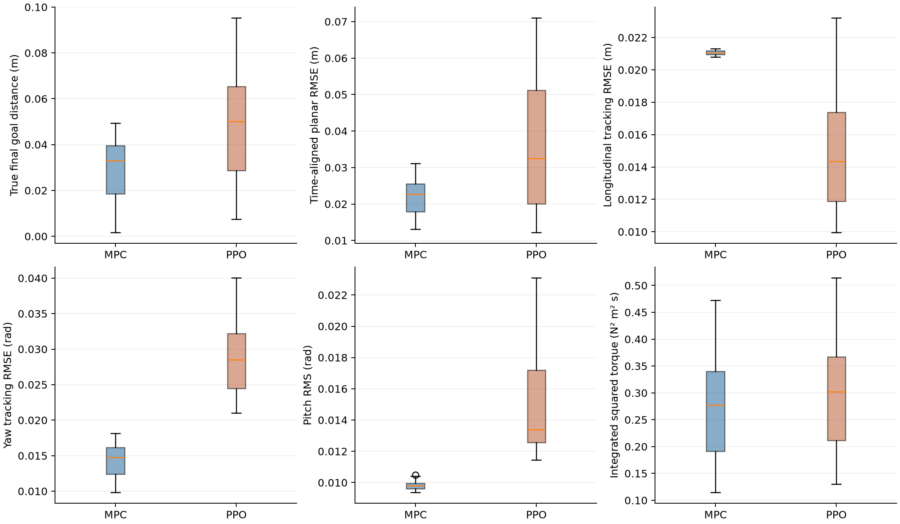
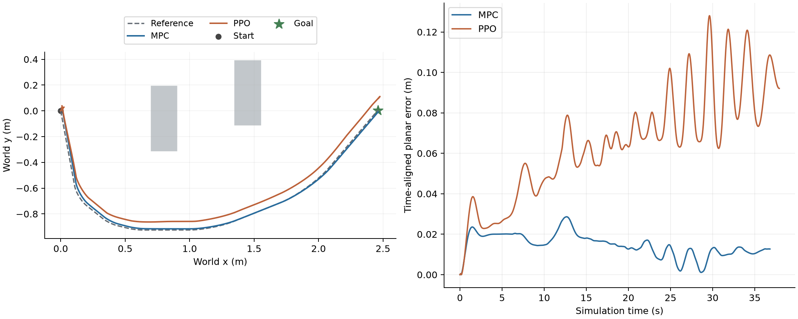
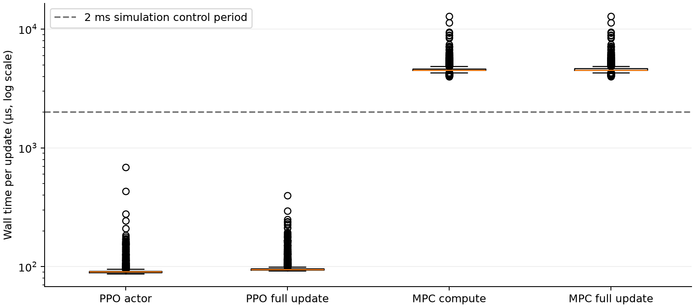

# Self-Balancing Robot Navigation with MPC and PPO

**Modern C++ · MuJoCo · ROS 2**

A two-wheeled robot balances, turns and follows routes around obstacles in a known map. IMU and wheel-encoder measurements drive state estimation. A shared planner generates a timed trajectory, and either a constrained model-predictive controller or a learned PPO policy converts that reference into independent wheel torques.

Pure C++ classes implement estimation, planning and control. Direct-call executables support controlled experiments, and ROS 2 adapters connect the same components across processes.

## Demo

[](Document/demo/controller_comparison.mp4)

**Same route, camera and initial state · 1× simulation speed.** The robot starts with the goal approximately 59° to its right. The green curve is the common reference, and the orange marker is the target. Both controllers reach and settle at the goal.

[Side-by-side MP4](Document/demo/controller_comparison.mp4) · [MPC MP4](Document/demo/mpc_obstacle_navigation.mp4) · [PPO MP4](Document/demo/ppo_obstacle_navigation.mp4)

## Results at a Glance

The final evaluation contains **100 paired obstacle-navigation tasks**, with 25 cases from each of four map families. Goal bearings cover −180° to +180° relative to the initial heading. Each pair uses the same physical reset, goal and timed reference trajectory.

<!-- NAVIGATION_RESULTS_BEGIN -->

| Metric | MPC | PPO |
|---|---:|---:|
| Settled successes | 100/100 | 100/100 |
| Falls / collisions / timeouts | 0 / 0 / 0 | 0 / 0 / 0 |
| Mean true final goal distance (m) | 0.028977 | 0.049744 |
| Mean time-aligned planar RMSE (m) | 0.022198 | 0.036628 |
| Mean longitudinal tracking RMSE (m) | 0.021061 | 0.01483 |
| Mean yaw tracking RMSE (rad) | 0.014402 | 0.028933 |
| Mean pitch RMS (rad) | 0.0098015 | 0.014645 |
| Mean integrated squared torque (N² m² s) | 0.26941 | 0.29492 |
| Mean successful completion time (s), n=100 each | 34.18 | 34.35 |

<!-- NAVIGATION_RESULTS_END -->

Success requires an estimated goal distance below 0.10 m, forward speed below 0.05 m/s, yaw rate below 0.10 rad/s and pitch below 0.10 rad for 0.50 s after the trajectory ends. Each episode has a timeout of trajectory duration + 10 s.

[Evaluation configuration, definitions and full distributions](docs/CONTROLLER_COMPARISON.md) · [Machine-readable results](docs/final_comparison.json)

## System Architecture



One controller branch owns the wheel commands in each run. Both consume estimated low-level state and the same future reference. The backend clamps each wheel torque to ±2 N·m and holds it between controller updates.

| Component | Responsibility |
|---|---|
| `robot_interface` | Sensor, estimated-state, reference and command structures |
| `state_estimator` | Sensor-based pitch, forward motion and yaw estimates |
| `navigation` | Planar odometry, occupancy grid, A*, geometry and trajectory timing |
| `controller` | PD, LQR and finite-horizon preview MPC |
| `learning_policy` | Observation construction and portable C++ neural inference |
| `mujoco_backend` | Physics ownership, sensors, actuation and viewer |
| `robot_msgs`, `robot_ros` | ROS interfaces, thin adapters and launch configurations |

### ROS 2 Runtime



ROS nodes wrap the C++ objects and manage timestamped messages, simulation time, synchronization and reset. The estimator receives separate IMU and encoder streams. State and command age checks produce explicit zero commands when data becomes stale. The backend coordinates simulation steps with the required control updates across separate processes.

Physics and estimation run at **1000 Hz simulated**, and control runs at **500 Hz simulated**. Viewer updates occur every 16 physics steps. The timing measurements below describe the wall-clock cost on the measurement machine.

[ROS topics, synchronization, QoS and reset protocol](docs/ROS2_INTEGRATION.md)

## Algorithms

### Robot and State Estimation

The model has a floating base, two independently actuated wheels, an IMU and wheel encoders. Its frame uses +X forward, +Y left and +Z up. Pitch rotates about Y, yaw about Z, and angles use radians. The nominal wheel radius is 0.12 m and half-track is approximately 0.155 m.

The estimator combines the accelerometer pitch angle with integrated gyro Y through a complementary filter. Wheel position and velocity include the pitch contribution to estimate forward displacement and speed. A reset origin defines the longitudinal coordinate. Gyro Z integration supplies wrapped yaw and yaw rate.

Planar odometry integrates estimated forward speed using midpoint heading,

$$
\dot{x}=v\cos\psi,\qquad \dot{y}=v\sin\psi.
$$

The navigation frame starts at the episode origin. Its accuracy depends on wheel traction and gyro integration. Ground-truth pose is recorded for evaluation and visualization.

### Known-Map Planning and Timed Trajectories

The planner inflates occupied cells by a 0.27 m footprint radius and a 0.15 m safety margin. Route search adds 0.10 m smoothing clearance. Eight-connected A* uses an octile heuristic and prevents diagonal corner cutting. Line-of-sight simplification reduces the grid route before collision-checked smoothing.

A geometric path provides tangent heading, cumulative arc length and curvature,

$$
\kappa=\frac{x'y''-y'x''}{(x'^2+y'^2)^{3/2}}.
$$

Moving-segment speed is limited by forward speed, lateral acceleration and yaw rate,

$$
v_{\mathrm{limit}}=\min\left(v_{\max},\sqrt{a_{\mathrm{lat}}/|\kappa|},
\omega_{\max}/|\kappa|\right).
$$

Forward acceleration and backward deceleration passes enforce

$$
v_i^2\leq v_{i-1}^2+2a_{\mathrm{acc}}\Delta s,
\qquad
v_i^2\leq v_{i+1}^2+2a_{\mathrm{dec}}\Delta s.
$$

The current limits are 0.16 m/s forward speed, 0.06 m/s² acceleration and deceleration, 0.025 m/s² lateral acceleration, 0.45 rad/s yaw rate and 0.35 rad/s² yaw acceleration. Explicit stopped rotations connect headings where required. During a stopped rotation, forward speed is zero and yaw follows its own angular profile.

Time parameterization produces position, heading, longitudinal distance, speed and yaw-rate references. At trajectory creation, the current estimated forward position becomes `position_origin`. Each low-level position reference is `position_origin + local_path_distance`. This preserves the balancing controller's longitudinal state semantics throughout the route.

### Preview MPC

MPC predicts six physical states and two wheel torques,

$$
x=[p,v,\theta,\dot\theta,\psi,\dot\psi]^T,
\qquad u=[\tau_L,\tau_R]^T.
$$

Exact zero-order-hold discretization gives $x_{k+1}=A_dx_k+B_du_k$. A 250-step horizon at 0.002 s covers the next 0.5 s. References are sampled at $t+T_s,\ldots,t+NT_s$, and yaw references are unwrapped locally around the current estimate.

The stacked prediction and tracking cost are

$$
X=S_xx_k+S_uU,
\qquad
J=(X-R)^T\bar Q(X-R)+U^T\bar R U.
$$

OSQP solves the torque-constrained quadratic program with

$$
H=2(S_u^T\bar Q S_u+\bar R),\qquad
f=2S_u^T\bar Q(S_xx_k-R).
$$

The terminal cost comes from the discrete algebraic Riccati equation. Constant prediction matrices and the Hessian are precomputed. Each update constructs the reference-dependent gradient, solves the QP and applies the first left/right torque pair.

### Trajectory-Conditioned PPO

PPO uses the same six low-level state quantities and all 250 future references. Each reference contains forward position, speed, pitch, yaw and yaw rate, producing **6 + 250 × 5 = 1256 inputs**.

Position and yaw use the current estimate as their local origin. Future yaw samples are unwrapped continuously. Fixed scales normalize position by 1 m, speed by 1 m/s, pitch by 0.35 rad, pitch rate by 2 rad/s, yaw by π rad and yaw rate by 2 rad/s. Normalized observations are clipped to ±5.

The actor is a **1256 → 128 tanh → 128 tanh → 2** feed-forward network. Its outputs are clipped to ±1 and multiplied by 2 N·m. The actor directly controls both wheels. Python training uses Stable-Baselines3 PPO and PyTorch. Runtime inference uses C++ dense layers and `tanh`.

Training progresses through balance, translation, turning and complete obstacle-route tracking. The final refinement adds full-circle turns and complete routes from independent training seeds. Its reward is

$$
r_t=\Delta t(1-C_t)+30I_{\mathrm{success}}-20I_{\mathrm{failure}},
$$

$$
C_t=(e_p/0.03)^2+(e_v/0.20)^2+(\theta_{\mathrm{true}}/0.10)^2
+(\dot\theta/1.0)^2+(e_\psi/0.10)^2+(e_{\dot\psi}/0.50)^2
+0.02(\tau_L^2+\tau_R^2).
$$

Tracking errors use estimated state and the current trajectory reference. Training uses true pitch for the posture cost and simulator contact information for failure detection. The actor receives the estimated-state observation throughout training and deployment.

The selected refinement checkpoint passed 40/40 independent validation routes after 1.5 million additional training transitions. Python/C++ export checks cover 100 fixed observations, including yaw wrapping. The largest normalized-action difference is below $1.6\times10^{-7}$.

[Final policy contract and training configuration](docs/CONTROLLER_COMPARISON.md#policy-and-reproduction)

### PD and LQR Baselines

PD provides pitch stabilization. LQR uses a four-state sagittal model for forward position, velocity, pitch and pitch rate, with equal wheel torque. These executables remain available for low-level regression and model-development experiments.

## Controller Comparison



Both methods completed all 100 tasks. MPC had lower mean planar tracking error, yaw error, pitch RMS and integrated squared torque. PPO had lower mean longitudinal tracking error. Longitudinal displacement and planar position measure different aspects of motion through a turning route.

### Where the Paths Differ Most



The staggered-obstacle route shown in the demo has the largest absolute difference in planar tracking RMSE across the 100 pairs. MPC's RMSE was 1.57 cm and PPO's was 7.04 cm. Their true final goal distances were 1.27 cm and 9.21 cm. Both met the common settled-success condition.

[Yaw, pitch and wheel-torque response](docs/figures/comparison/tracking_response.png)

### Computation



<!-- COMPUTE_RESULTS_BEGIN -->

| Computation (µs) | Mean | Median | p95 | p99 | Maximum |
|---|---:|---:|---:|---:|---:|
| PPO actor | 91.89 | 90.58 | 95.84 | 126.2 | 689.6 |
| PPO full update | 96.55 | 95.04 | 99.92 | 139 | 397.2 |
| MPC compute | 4580 | 4519 | 4825 | 5669 | 1.287e+04 |
| MPC full update | 4584 | 4523 | 4829 | 5673 | 1.287e+04 |

<!-- COMPUTE_RESULTS_END -->

Measurements use `std::chrono::steady_clock` in Release on an Apple M4, with 500 warm-up updates followed by 5,000 measured updates. Full updates include reference-horizon sampling. MPC compute includes gradient construction, QP solution and command extraction. Actor-only timing measures neural inference.

The simulation's control period is 2 ms. These measurements characterize computation on this machine. The simulator advances according to its configured simulation-time schedule.

## Build and Run

The checked-in Pixi environment targets Apple Silicon macOS with RoboStack ROS 2 Jazzy. The native backend links MuJoCo 3.12.0 from `/Applications/MuJoCo.app/Contents/Frameworks`. The Python simulation uses the same MuJoCo version.

From the repository root,

```bash
pixi install --frozen
pixi run --frozen bash -c 'cd ros2_ws && colcon build --cmake-args -DCMAKE_BUILD_TYPE=Release'
pixi run --frozen bash -c 'cmake -S tools/trajectory_learning -B build/trajectory_learning -DCMAKE_BUILD_TYPE=Release -Dpybind11_DIR=$(python -m pybind11 --cmakedir) && cmake --build build/trajectory_learning -j 4'
```

### Direct-Call Demonstrations

```bash
pixi run --frozen ros2_ws/build/mujoco_backend/trajectory_policy_smoke_test \
  model/Robot1.xml model/known_map.txt mpc

pixi run --frozen ros2_ws/build/mujoco_backend/trajectory_policy_smoke_test \
  model/Robot1.xml model/known_map.txt \
  artifacts/learning/d18_selected_full_circle_v2/actor.txt
```

Add `--headless` for quantitative smoke tests and `--trace output.csv` to save the estimated state and torque sequence. Existing `pd_smoke_test`, `lqr_smoke_test`, `mpc_smoke_test`, `navigation_smoke_test` and `known_map_smoke_test` remain in the same build directory.

### ROS Launch

```bash
pixi run --frozen bash
source ros2_ws/install/local_setup.bash
export ROS_DOMAIN_ID=61
ros2 launch robot_ros simulation.launch.py mode:=known_map viewer:=true duration:=44.0
```

For the learned trajectory controller, start a new launch after the previous one exits,

```bash
ros2 launch robot_ros trajectory_ppo.launch.py viewer:=true duration:=45.0
ros2 service call /reset std_srvs/srv/Trigger '{}'
```

The trajectory PPO launch loads the selected full-circle actor from the package share directory. A launch argument can select an actor explicitly.

### Tests and Results

```bash
pixi run --frozen python -m unittest \
  tools.learning.checks tools.trajectory_learning.checks \
  tools.trajectory_learning.runtime_checks tools.trajectory_learning.full_circle_checks \
  tools.trajectory_learning.retraining_checks tools.trajectory_learning.final_checks

pixi run --frozen python -m tools.trajectory_learning.final_report
```

Functional validation covers 47 Python checks and 14 C++ tests, plus ROS reset, freshness and transport-parity experiments. The workspace also retains 12 reported uncrustify formatting failures in the controller and estimator packages. [Validation record](docs/final_validation.json)

The report command regenerates figures and tables from the saved final evaluation records. The detailed report provides commands for producing those records, measuring computation and checking ROS/direct-call parity.

[Benchmark and reproduction guide](docs/CONTROLLER_COMPARISON.md)

## Repository and Technical Notes

```text
model/                     Robot dynamics and known-map descriptions
ros2_ws/src/               C++ algorithm packages and ROS adapters
tools/mpc_design.py        Numerical controller design
tools/learning/            Goal-conditioned policy development tools
tools/trajectory_learning/ Trajectory policy training, export and evaluation
docs/                      Design notes and measured results
Document/demo/             Comparison videos and GIF preview
```

The current system operates in MuJoCo with static known maps and wheel/gyro odometry. Its local linear MPC and trajectory policy track longitudinal motion and heading. Planar path error is measured offline. Planning validates the reference against inflated obstacles, while the evaluation records physical contacts during execution. Hardware experiments, absolute localization and dynamic-obstacle handling remain future extensions.

[Detailed comparison](docs/CONTROLLER_COMPARISON.md) · [ROS integration](docs/ROS2_INTEGRATION.md)
