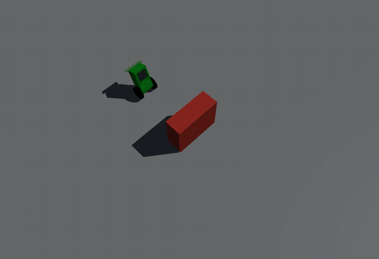
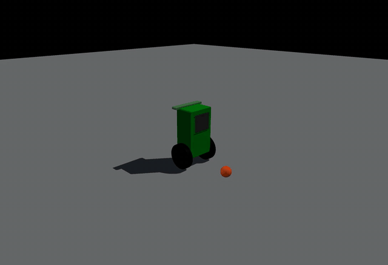
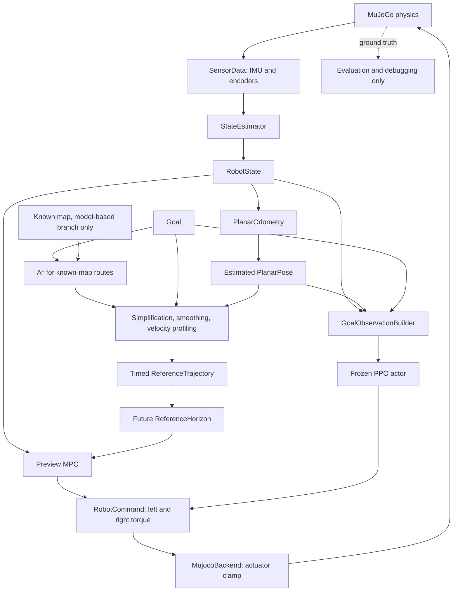
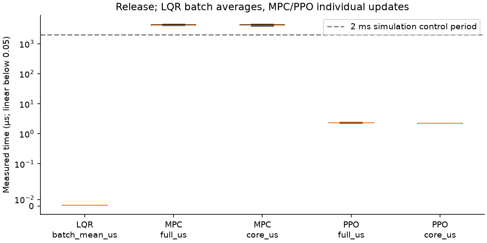
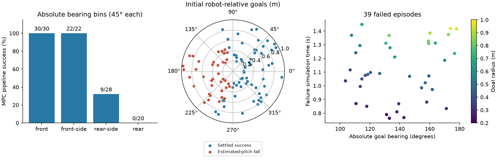
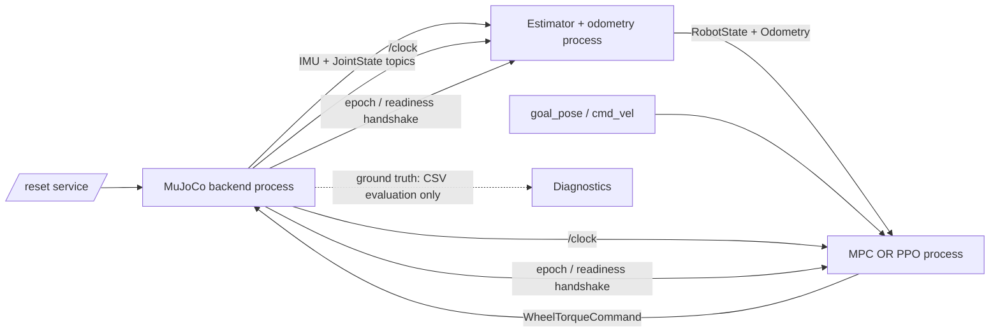

# ROS 2 + MuJoCo Mobile Balancing Robot Framework

A simulation robotics framework with sensor-based state estimation, PD/LQR/MPC control, finite-horizon trajectory preview, planar odometry, known-map A* navigation, and goal-conditioned PPO that directly commands wheel torques. Pure C++ algorithms are separated from the MuJoCo backend. ROS 2 Jazzy runs thin backend, estimator/odometry and controller adapters in separate processes, with timestamped sensor topics, simulation time and coordinated reset. The direct-call experiments remain available as the algorithmic reference.

This repository evaluates two distinct approaches to obstacle-free goal reaching: a geometric trajectory followed by preview MPC, and a learned actor operating directly on estimated state and a goal. It also retains simpler sagittal controller baselines and a known-map planning demonstration. All results are simulation measurements, with no real-hardware validation or hard real-time guarantee.

## Demos

Actual MuJoCo renderings from the existing C++ smoke tests. GIF previews play at **2× simulation time**; click a preview for the **1× simulation-time MP4**. Playback speed is independent of the wall time required to run or record the simulation.

| Known-map navigation: A* → trajectory → MPC | Goal-only control: estimated state + goal → PPO |
| --- | --- |
| [](Document/demo/known_map.mp4) | [](Document/demo/ppo.mp4) |
| Obstacle, planned route, reference trajectory and target are visible. | Only the target is supplied; no path or recovery controller is used. |

These are presentation scenarios, not replacements for the random-goal benchmark. Recording metadata and run results: [known-map demo](Document/demo/known_map.json), [PPO demo](Document/demo/ppo.json).

## Key results

<!-- KEY_RESULTS_BEGIN -->

- **MPC, common D16 random goals:** 61/100 settled successes; 39 estimated-pitch falls; mean true final distance 0.2548 m.
- **PPO, common D16 random goals:** 83/100 settled successes; 0 estimated-pitch falls; mean true final distance 0.0990 m.
- **LQR measured batch-mean per call:** p95 0.001422 µs, maximum 0.002445 µs on the recorded Release platform.
- **MPC measured full update:** p95 4411 µs, maximum 5583 µs on the recorded Release platform.
- **PPO measured full update:** p95 2.375 µs, maximum 7.042 µs on the recorded Release platform.

<!-- KEY_RESULTS_END -->

The separate D15 PPO final test achieved **87/100** settled random-goal successes with **zero falls** from near-upright resets. Its −20° startup challenge achieved 8/10 estimated successes with two falls. These historical learning evaluations use different seeds and reset perturbations from D16 and are not a substitute for the common comparison. See the [recorded learning results](docs/learning/d17_results.json) and [complete development history](docs/learning/PPO_DEVELOPMENT_HISTORY.md).

## Navigation

- [Demos](#demos)
- [Architecture and robot](#architecture)
- [State estimation](#state-estimation)
- [Controllers and MPC](#controllers)
- [Trajectories and known-map planning](#trajectory-generation-and-planning)
- [PPO branch](#goal-conditioned-ppo)
- [Unified evaluation](#d16--unified-evaluation-and-benchmarking)
- [ROS 2 runtime](#ros-2-runtime-architecture)
- [Build and run](#build-and-run)
- [Limitations](#limitations)

## Architecture



The diagram shows alternative actuator branches; their torques are not blended. Obstacle-free MPC uses the existing point-to-point trajectory generator without A*. PPO receives the goal but no map, path, trajectory or reference horizon.

Design boundaries:

- `robot_interface` defines sensor, estimated-state, reference and command data. Controller code consumes estimates rather than MuJoCo state arrays.
- `state_estimator`, `controller`, `navigation` and `learning_policy` contain pure C++ algorithms. Planning does not include MuJoCo or OSQP; MPC does not depend on map geometry; PPO is independent of MPC.
- `MujocoBackend` owns physics, sensor extraction and actuator application. Each wheel is clamped to ±2 N·m in the backend.
- Planning generates references above low-level balancing control. Global x/y are not added to the MPC state.
- The interfaces support later backend replacement, but a tested hardware backend is not implemented. The ROS simulation adapters preserve the pure-C++ algorithm interfaces.

### Robot and frames

The MJCF contains a 3D floating base, two independently actuated wheels, simulated IMU accelerometer/gyroscope and wheel position/velocity encoders. Motors accept torque commands.

| Quantity | Nominal value / convention |
|---|---|
| Forward / left / up | +X / +Y / +Z |
| Pitch / yaw axes | +Y / +Z; radians |
| Positive yaw | Counter-clockwise viewed from above |
| Wheel radius | 0.12 m |
| Half track | Approximately 0.155 m |
| Main body mass | 2.0 kg; wheels and small additional bodies are also modeled |
| Main body box half sizes | 0.10 × 0.12 × 0.22 m |
| Wheel torque limit | ±2 N·m independently |

The authoritative plant is [Robot1.xml](model/Robot1.xml). Its original initial pitch is −20°. Nominal learning and common benchmarking use an upright reset adapter without changing physical parameters or the checked-in model. Startup challenge results are reported separately.

### Update schedule

Physics, state estimation and odometry run at 1000 Hz. Controllers update at 500 Hz; the most recent command is held across two physics steps. Viewer demos render at approximately 60 Hz. Simulation cadence does not establish a hard real-time guarantee; direct wall-clock measurements appear in the computation results below.

## State estimation

Pitch uses a complementary filter, not an EKF. With filter time constant T = 0.5 s:

```text
theta_accel = atan2(-a_x, a_z)
alpha = T / (T + dt)
theta_k = alpha (theta_(k-1) + gyro_y dt) + (1-alpha) theta_accel
```

Wheel encoders are relative to the body. Forward displacement and speed include body pitch motion:

```text
p = r ((q_L + q_R)/2 + theta) - reset_origin
v = r ((wheel_rate_L + wheel_rate_R)/2 + gyro_y)
yaw_k = wrap_to_pi(yaw_(k-1) + gyro_z dt)
pitch_rate = gyro_y
yaw_rate = gyro_z
```

Planar odometry integrates the estimated speed using midpoint yaw:

```text
x_dot = v cos(yaw)
y_dot = v sin(yaw)
```

The estimate assumes low slip and locally meaningful accelerometer tilt. Acceleration contaminates accelerometer-based pitch; integrated yaw drifts, and encoder odometry does not provide absolute global localization. Estimator and odometry reset at the episode boundary. MuJoCo body pose is logged separately for error analysis and never initializes a control observation.

## Controllers

### PD and LQR baselines

PD stabilizes pitch. It does not implement the position or 2D goal-reaching task, so it is not ranked against those pipelines.

LQR uses the sagittal state `[position, velocity, pitch, pitch_rate]`, a continuous linearized model and CARE state-feedback design. The design script checks rank-four controllability. Both wheels receive the same unconstrained request; the backend still clamps actual torque. The frozen baseline gains are `[-6.66667, -6.57554, -18.36740, -3.00994]`. This is a local forward-regulation controller without a yaw goal interface.

Detailed derivations and earlier saturation experiments remain in the [preserved design/development notebook](docs/learning/PPO_DEVELOPMENT_HISTORY.md). The earlier 5 m LQR failure is not used as a normal local-regulation benchmark.

### Finite-horizon preview MPC

The physical prediction state and action are:

```text
x = [p, v, pitch, pitch_rate, yaw, yaw_rate]
u = [tau_L, tau_R]
```

Each wheel supplies half of the old equal-wheel sagittal input matrix. The yaw subsystem models differential torque, with its sign checked in simulation. Exact zero-order-hold discretization uses an augmented matrix exponential. The frozen horizon is N = 250 with Ts = 0.002 s, giving 0.5 s of preview and 500 torque decision variables.

Stacked predictions and references are:

```text
X = [x_(k+1), ..., x_(k+N)] = Sx x_k + Su U
r_i = [p_ref_i, v_ref_i, pitch_ref_i, 0, yaw_ref_i, yaw_rate_ref_i]
R = [r_(k+1), ..., r_(k+N)]
```

The tracking objective and OSQP form are:

```text
J = (X-R)^T Qbar (X-R) + U^T Rbar U
minimize 1/2 U^T H U + f^T U
H = 2 (Su^T Qbar Su + Rbar)
f = 2 Su^T Qbar (Sx x_k - R)
subject to -2 <= tau_L(i), tau_R(i) <= 2 N·m
```

The terminal weight is the full six-state discrete DARE solution. Constant prediction/cost matrices are precomputed; each update samples future references, builds the gradient and solves the constrained QP. Only the first left/right pair is applied. Yaw references are locally unwrapped from the current estimated yaw to avoid ±π discontinuities while public state/reference angles remain wrapped.

The physical-state preview formulation replaced a reference-centered error regulator. Stationary zero-velocity/zero-rate references remain equivalent; a moving physical reference must be represented explicitly rather than forcing zero error dynamics. Time indexes trajectory samples and is not a state or cost term.

MPC is a local linear receding-horizon controller, not a globally optimal nonlinear planner. The state does not directly penalize world-frame lateral or cross-track error.

## Trajectory generation and planning

A geometric path describes where to move; a timed trajectory also specifies when and how fast. Obstacle-free navigation uses the existing cubic Hermite point-to-point geometry with its start tangent aligned to estimated yaw, cumulative sampled arc length, tangent heading and bounded acceleration/deceleration timing. Its normal limits are 0.18 m/s and 0.08 m/s² in the common benchmark.

The known-map branch adds occupancy-grid geometry, inflation, 8-connected A* with an octile heuristic and diagonal corner-cut prevention, collision-checked line-of-sight simplification, and multi-segment smoothing. Smoothing is validated against the inflated map; stop-and-turn segments provide a fallback when a moving corner cannot be represented safely by the reference geometry.

For smooth moving segments:

```text
s_i = s_(i-1) + ||point_i - point_(i-1)||
yaw_ref = atan2(y', x')
kappa = (x' y'' - y' x'') / (x'^2 + y'^2)^(3/2)
yaw_rate_ref = v_ref kappa
v_limit = min(v_max, sqrt(a_lat_max / |kappa|), yaw_rate_max / |kappa|)
v_i <= sqrt(v_(i-1)^2 + 2 a_accel delta_s)       [forward pass]
v_i <= sqrt(v_(i+1)^2 + 2 a_decel delta_s)       [backward pass]
delta_t = 2 delta_s / (v_i + v_(i+1))
```

Near-zero curvature/derivatives and zero-speed endpoints have explicit handling. In-place turns have zero linear speed and nonzero yaw rate; curvature is undefined and is not computed as yaw rate divided by speed. Sampling after completion holds the final distance/heading with zero linear/angular rates.

The longitudinal MPC reference remains `position_origin + local_path_distance`, where the origin is the estimated forward position at trajectory creation. The existing `ReferenceTrajectory` and `ReferenceHorizon` interfaces connect both geometry generators to the same MPC.

### Known-map capability, not a PPO comparison

[The shared scenario](model/known_map.txt) specifies a 0.05 m grid and a wall blocking the direct route to (2.4, 0) m. Planner occupancy and physical obstacle generation use that description. The default planning radius is 0.27 m, safety margin 0.15 m, with an additional 0.10 m routing/smoothing clearance. Known-map motion limits are 0.16 m/s, 0.06 m/s² longitudinal acceleration/deceleration, 0.025 m/s² lateral acceleration and 0.45 rad/s yaw rate.

The separate `known_map_smoke_test` validates the reference against inflated occupancy, draws the obstacle, raw route, simplified waypoints, final trajectory and target, and executes preview MPC. Its measured capability result and regression log are documented in [D16 evaluation](docs/D16_UNIFIED_BENCHMARK.md#known-map-capability).

<!-- KNOWN_MAP_RESULT_BEGIN -->

| Known-map capability metric | Measured value |
| --- | --- |
| Total simulated duration (including startup recovery) | 43.37 s |
| estimated goal error | 0.02264 m |
| debug true goal error | 0.02056 m |
| max torque | 0.5145 N·m |
| max pitch after recovery | 0.01909 rad |
| max odometry error | 0.00351 m |

<!-- KNOWN_MAP_RESULT_END -->

PPO has no map/obstacle observation and was trained for obstacle-free goals. Running it blindly into this wall would not be an equivalent comparison. Reference collision checking and conservative clearance are not a universal closed-loop collision guarantee.

## Goal-conditioned PPO

The learning branch maps estimated state and a goal directly to left/right wheel torque. It contains no hidden PD, LQR, MPC, trajectory tracking or recovery controller.

```text
dx = goal_x - estimated_x
dy = goal_y - estimated_y
goal_forward = cos(yaw) dx + sin(yaw) dy
goal_left    = -sin(yaw) dx + cos(yaw) dy
observation = [goal_forward, goal_left, v, pitch, pitch_rate, yaw_rate]
```

Fixed normalization scales are `[1 m, 1 m, 1 m/s, 0.35 rad, 2 rad/s, 2 rad/s]`, with normalized values clipped to ±5. The actor is `6 → 64 tanh → 64 tanh → 2 linear`, followed by action clipping to ±1 and multiplication by 2 N·m. Training uses Stable-Baselines3 PPO; the small C++ evaluator loads the exported deterministic MLP rather than implementing PPO optimization.

Curriculum stages progress from balance/hold through forward/backward goals to arbitrary local 2D bearings and radii. Training-side estimator equations are checked against C++ sensor traces. Privileged simulator information is restricted to training reward, failure/evaluation statistics and diagnostics; actor observations remain estimated-state based.

The final training reward uses distance progress, time-integrated pitch/effort/yaw-rate penalties, success/fall events, and a discounted heading potential difference `gamma Phi(next) - Phi(current)`. A standalone turning incentive previously rewarded circling without settling and was replaced after diagnosis. Narrow inherited action exploration was also measured and explicitly restarted during curriculum transfer. Neither issue was addressed by inserting another controller.

The selected actor is `artifacts/learning/d_full_potential/best_validation.zip`, exported as `artifacts/learning/selected_policy.txt`. Historical nominal held-out success is 87/100, with 13 timeouts just outside the goal boundary and zero falls; the more flattering development audit is not presented as the final test. Precise endpoint stopping and original tilted-start robustness remain limitations. Full reward equations, hyperparameters, source snapshots, learning curves, parity measurements and failed experiments are preserved in [PPO development history](docs/learning/PPO_DEVELOPMENT_HISTORY.md).

## D16 — Unified Evaluation and Benchmarking

Algorithms, plant, actor weights and benchmark settings are frozen before evaluation. There is no aggregate score or universal controller ranking.

| Group | Task | Methods | Reason |
|---|---|---|---|
| A | Local sagittal regulation and standardized force pulse | LQR / MPC | Shared forward-regulation capability |
| B | Obstacle-free 2D settled goal reaching | Trajectory + MPC / direct PPO | Shared external task and paired goals |
| C | Disturbed 2D goal reaching | Trajectory + MPC / direct PPO | Identical pulse, timing and task |
| D | Direct controller computation | LQR / MPC / PPO | Explicit timing scopes |
| E | Known-map route execution | Model-based capability only | PPO lacks obstacle observations |

The common set contains 100 new random goals plus eight fixed directional checks. Radius is uniform over 0.2–1.0 m and bearing over the full circle, generated once with seed 216000 and reused by both branches. Resets are upright and stationary, without controller-specific startup assistance. This differs from the small reset perturbations in historical PPO evaluation.

Success requires estimated distance <0.10 m, |v| <0.05 m/s, |yaw rate| <0.10 rad/s and |pitch| <0.10 rad continuously for 0.50 s, within a shared 15 s timeout. Failure detection uses |estimated pitch| >0.7 rad in the common C++ benchmark; it is not a comprehensive true-contact fall classifier. True position is used only for separate endpoint and traveled-path measurements.

The standardized pulse is −50 N along the current body-local X axis for 50 ms starting at 5 s. Both 2D methods also run matched clean trials for path/effort differences. Pitch and regulation metrics are estimated-state quantities. Squared torque integration measures control effort, not mechanical energy. Path efficiency can exceed one because completion is inside a goal region rather than at its center.

All episode statistics retain failures except explicitly labeled successful completion/recovery times. Full mean, median, population standard deviation, p95 and worst-case distributions, exact formulas, raw files and timing caveats are in [the detailed evaluation document](docs/D16_UNIFIED_BENCHMARK.md).

<!-- BENCHMARK_RESULTS_BEGIN -->

### Sagittal regulation: LQR and MPC


| Trial | Method | Position RMSE (m) | Final error (m) | Max pitch (rad) | ∫τ²dt | Saturation (s) | Recovery (s) |
| --- | --- | --- | --- | --- | --- | --- | --- |
| -0.20 m | LQR | 0.05484 | 0.02025 | 0.06313 | 0.05093 | 0.002 | — |
| -0.20 m | MPC | 0.05495 | 0.02041 | 0.06299 | 0.04339 | 0 | — |
| -0.10 m | LQR | 0.03284 | 0.02025 | 0.03248 | 0.01342 | 0 | — |
| -0.10 m | MPC | 0.03295 | 0.02041 | 0.03242 | 0.01091 | 0 | — |
| -0.05 m | LQR | 0.02381 | 0.02025 | 0.01725 | 0.003554 | 0 | — |
| -0.05 m | MPC | 0.02394 | 0.02041 | 0.01721 | 0.002893 | 0 | — |
| +0.05 m | LQR | 0.02171 | 0.02025 | 0.02174 | 0.004265 | 0 | — |
| +0.05 m | MPC | 0.02185 | 0.02041 | 0.02182 | 0.003606 | 0 | — |
| +0.10 m | LQR | 0.02937 | 0.02025 | 0.03116 | 0.01477 | 0 | — |
| +0.10 m | MPC | 0.02947 | 0.02041 | 0.03124 | 0.01226 | 0 | — |
| +0.20 m | LQR | 0.05055 | 0.02025 | 0.05962 | 0.05379 | 0.002 | — |
| +0.20 m | MPC | 0.05062 | 0.02041 | 0.05952 | 0.04616 | 0 | — |
| +0.10 m + pulse | LQR | 0.1106 | 0.02151 | 0.3812 | 0.3767 | 0 | — |
| +0.10 m + pulse | MPC | 0.1113 | 0.02178 | 0.3811 | 0.3713 | 0 | — |


### Common obstacle-free goal reaching: 100 paired random goals


| Method | Success | Falls | Timeouts | Final true distance, mean (m) | Successful time, mean (s) | Path length, mean (m) | RMS pitch, mean (rad) | ∫τ²dt, mean |
| --- | --- | --- | --- | --- | --- | --- | --- | --- |
| MPC | 61/100 | 39 | 0 | 0.2548 | 5.485 | 0.4804 | 0.05766 | 0.6817 |
| PPO | 83/100 | 0 | 17 | 0.09897 | 9.664 | 0.5119 | 0.01135 | 0.1108 |

| Method | Estimated final distance, mean (m) | Efficiency ratio, mean | Pitch, worst (rad) | Torque, worst (N·m) | ∫|τ|dt, mean | Saturation, mean (s) |
| --- | --- | --- | --- | --- | --- | --- |
| MPC | 1.138 | 1.264 | 0.7183 | 2 | 0.8387 | 0.07664 |
| PPO | 0.0979 | 1.122 | 0.08445 | 0.9142 | 1.085 | 0 |


### Disturbed goal reaching: eight paired fixed directions


| Method | Task success | Falls | Pulse exposed | Failures before pulse | Peak post-push pitch, worst (rad) | Goal-distance increase, worst (m) | Successful recovery, mean (s) | Additional path, mean (m) | Additional ∫τ²dt, mean |
| --- | --- | --- | --- | --- | --- | --- | --- | --- | --- |
| MPC | 5/8 | 3 | 5 | 3 | 0.3835 | 0.4322 | 4.614 | 0.7734 | 0.2214 |
| PPO | 8/8 | 0 | 8 | 0 | 0.1894 | 0.7603 | 7.827 | 1.821 | 0.2143 |


### Isolated Release computation: microseconds per update


| Method / scope | Samples | Mean | Median | p95 | p99 | Maximum |
| --- | --- | --- | --- | --- | --- | --- |
| LQR / batch_mean_us | 2000 | 0.001351 | 0.001337 | 0.001422 | 0.001548 | 0.002445 |
| MPC / full_us | 5000 | 4220 | 4220 | 4411 | 4668 | 5583 |
| MPC / core_us | 5000 | 4218 | 4219 | 4408 | 4666 | 5581 |
| PPO / full_us | 5000 | 2.304 | 2.292 | 2.375 | 2.417 | 7.042 |
| PPO / core_us | 5000 | 2.262 | 2.25 | 2.292 | 2.375 | 9.75 |

LQR entries describe 2000 batch averages, each over 100000 production calls, after 100 warm-up batches. They include indexed input loads and output stores. Their p99/maximum are batch-average statistics, not single-call latency bounds. MPC/PPO retain the original individual-update measurements.

<!-- BENCHMARK_RESULTS_END -->





Timing uses `std::chrono::steady_clock` in Release builds. MPC/PPO retain 5000 individual measurements after 500 warm-up updates. The final audit replaces quantized single-call LQR readings with batch means; the table states its separate sample counts and scope. `full_us` includes reference-horizon construction for MPC or observation/inference/action scaling for PPO. MPC `core_us` includes gradient update, OSQP solve and first-command extraction; the frozen public API does not expose a pure solver timer. PPO `core_us` times actor evaluation on an already constructed observation. No wall-clock result is inferred from physics throughput, rendering or training duration.

Measured times apply to the recorded machine and isolated run, not a hard real-time guarantee. Full timing distributions include outliers; the timing figure hides outlier markers for readability while tables retain p99 and maximum.

### Interpreting the measurements

The sagittal step responses are close, but both retain a final position offset outside the tighter settling band; null settling/recovery entries are not zero-time recovery. The benchmark records that behavior without retuning gains or attributing the offset to an unisolated cause. LQR briefly reaches the actuator clamp in the largest local steps, while the constrained MPC does not in these trials.

The 2D result compares complete goal-reaching pipelines. The unchanged trajectory-plus-MPC branch fails on part of the full-circle goal distribution, while PPO has near-boundary timeouts. Successful completion-time averages use each method's own successful subset, so the lower MPC average is not proof of faster completion on every paired goal. This experiment does not isolate trajectory geometry from feedback-model limitations, nor establish a universal controller ranking.

In the disturbance group, the three MPC failures also occur in their matched clean trials **before the pulse begins**. Only five MPC trials and all eight PPO trials actually receive the pulse; those exposed trials reach the goal. The task-level success counts must not be interpreted as three push-induced MPC failures. Additional path and effort include differing episode termination times.

MPC's measured full-update distribution exceeds the 2 ms simulation period on this machine. The simulation still advances at its prescribed timestep, but this measurement does not support wall-clock 500 Hz operation. PPO updates are substantially shorter in this workload. LQR now uses measured batch averages of production calls, including indexed loads/stores. Its percentiles and maximum are not single-call latency bounds and should not be directly interpreted as equivalent tail statistics to MPC/PPO. The original quantized readings remain in the raw archive.

### Final audit: failure distribution and odometry

<!-- D16_AUDIT_BEGIN -->

| Absolute initial bearing | MPC settled successes | Estimated-pitch falls |
| --- | --- | --- |
| 0–45° | 30/30 | 0 |
| >45–90° | 22/22 | 0 |
| >90–135° | 9/28 | 19 |
| >135–180° | 0/20 | 20 |

Failures are concentrated in rear-side/rear goals. All failed trials reach the wheel clamp; successful trials do not. This is the measured behavior of the existing trajectory-plus-MPC pipeline on this distribution, not an isolated diagnosis of MPC feedback.

| MPC subset | Episodes | Mean estimated distance (m) | Mean true distance (m) | Mean absolute distance discrepancy (m) |
| --- | --- | --- | --- | --- |
| success | 61 | 0.03006 | 0.0314 | 0.001364 |
| fall | 39 | 2.87 | 0.6042 | 2.266 |

The distance formulas reproduce the raw logs exactly. Reintegrating recorded velocity/yaw rate reproduces odometry to 6.342e-13 m. The large aggregate discrepancy is dominated by failed episodes: wheel/gyro odometry and true position separate **before termination**. 33 of 39 failed trials exceed 0.10 m pose discrepancy before estimated pitch first exceeds 0.10 rad. There is no post-termination trace, true-pitch trace or contact log establishing a particular physical fall/slip mechanism. These findings support breakdown of the low-slip/upright odometry assumptions during the failure transient, not a reporting or stale-state bug. Original outcomes and distances are retained.



<!-- D16_AUDIT_END -->

The [D16 audit details](docs/D16_UNIFIED_BENCHMARK.md#final-audit) include unchanged diagnostic replays, batch timing calibration and reproduction commands. Learning notes remain in the [development history](docs/learning/PPO_DEVELOPMENT_HISTORY.md#d16-final-audit--reading-benchmark-results-without-changing-the-controller).

## ROS 2 Runtime Architecture

D17 adds two packages around the frozen algorithms: `robot_msgs` defines the estimated state and wheel-torque transport contracts; `robot_ros` owns ROS callbacks, parameters, timestamp pairing and launch. Estimation and planar odometry share one adapter process. MPC and PPO have separate executables, and launch starts only one actuator-command branch.



Physics advances in a timestamped lockstep handshake: 1000 Hz simulated sensor/estimator updates, and a fresh controller command every second physics step. Torque is held between 500 Hz updates. A wall timer polls readiness; it does **not** define simulation frequency. Single-threaded executors and bounded timestamp buffers make ownership explicit. This implementation tests real DDS/process boundaries while deliberately controlling sample delay; it is not an asynchronous hardware timing claim.

Measurement time comes from MuJoCo `/clock`, not callback arrival time. IMU and wheel streams remain separate, with exact pairing at equal rates and documented wheel-sample hold for integer encoder decimation. State and command freshness are checked in simulated time; wall watchdogs also detect a stopped clock/process. Missing, stale or invalid data produces zero torque, with no recovery-controller substitution. Reset uses a new monotonic simulation epoch and acknowledgments from the stateful adapters before physics resumes.

### D17 measured integration results

<!-- ROS_RESULTS_BEGIN -->

| Distributed experiment | Measured result |
|---|---|
| MPC regulation, 12 s | 12000 states, 6000 commands; no fallback |
| Direct/ROS maximum position difference | 1.143e-13 m |
| Direct/ROS maximum pitch difference | 2.414e-13 rad |
| Direct/ROS maximum requested torque difference | 1.376e-10 N·m |
| PPO presentation goals | 4/4 settled; fourth success at 34.648 s |
| PPO peak estimated pitch / applied torque | 0.026646 rad / 0.607607 N·m |
| Known-map estimated / true final error at 44 s | 0.022636 / 0.020560 m |
| Known-map trajectory duration / post-recovery peak pitch | 34.366586 s / 0.019087 rad |
| Known-map obstacle contact samples | 0 |
| 1000 Hz IMU / 500 Hz encoder trial, 2 s | 2000 IMU, 1000 encoder, 1000 commands |
| ROS PPO torque parity, 3 vectors | max error 3.381e-08 N·m |
| Frozen file comparison | 95 files checked; zero changes |

<!-- ROS_RESULTS_END -->

The PPO result is a four-goal integration demonstration, not a new random-goal generalization estimate. Known-map error is measured after 44 simulated seconds including recovery. D16 controller computation measurements and all benchmark outcomes remain unchanged. Full timing distributions, message/QoS contracts, failure tests and reproduction commands are in [D17 integration notes](docs/D17_ROS2_INTEGRATION.md); generated values trace to [the result snapshot](docs/ros2_integration_results.json).

### Launch and commands

After the Release build below, use a Pixi shell with the workspace overlay sourced:

```bash
pixi run --frozen bash
source ros2_ws/install/local_setup.bash
ros2 launch robot_ros model_based.launch.py
# Alternative, exclusive controller modes:
ros2 launch robot_ros ppo.launch.py
ros2 launch robot_ros known_map.launch.py
# Viewer or manual commands:
ros2 launch robot_ros simulation.launch.py mode:=goal viewer:=true duration:=30.0
```

Run only one launch at a time in the same ROS domain. From another sourced shell:

```bash
ros2 service call /reset std_srvs/srv/Trigger '{}'
ros2 topic pub --once /goal_pose geometry_msgs/msg/PoseStamped \
  '{header: {frame_id: odom}, pose: {position: {x: 0.4, y: 0.1}, orientation: {w: 1.0}}}'
# Only with mode:=velocity; publish periodically, timeout is 0.5 simulated seconds.
ros2 topic pub -r 10 /cmd_vel geometry_msgs/msg/Twist \
  '{linear: {x: 0.03}, angular: {z: 0.1}}'
```

Launch parameters are startup configuration; adapter parameters are read-only after construction. Paths resolve through package share. The PPO launch requires the selected local actor artifact to have been installed by the build. No actor is downloaded or retrained automatically. See [D17](docs/D17_ROS2_INTEGRATION.md#reproduction) for headless comparisons, fault injection, rosbag and installed-runtime caveats.

## Repository structure

```text
model/                         Robot1.xml and shared known-map scenario
ros2_ws/src/
  robot_interface/             Sensor/state/reference/command structures
  mujoco_backend/              Physics, viewer, demos and benchmark executable
  state_estimator/             Complementary filter and sensor-derived state
  controller/                  PD, LQR, six-state preview MPC
  navigation/                  Odometry, trajectories, grid planning
  learning_policy/             Observation builder and exported MLP inference
  robot_msgs/                  ROS-only process-boundary messages
  robot_ros/                   Thin process adapters, YAML and launch/bringup
tools/
  lqr_design.py, mpc_design.py  Numerical controller design/verification
  learning/                    PPO environment, training, evaluation and export
  benchmark/                   Frozen scenarios, orchestration, metrics/reporting
  ros2/                        Distributed experiments, fault tests and reports
docs/
  D16_UNIFIED_BENCHMARK.md      Evaluation definitions and complete distributions
  D17_ROS2_INTEGRATION.md       ROS graph, timing, reset and measured integration
  learning/                    Preserved development history and PPO results
  figures/                     Generated measured plots
artifacts/                     Local generated weights, logs and raw evaluations
```

## Build and run

The recorded setup uses macOS Apple Silicon, Pixi with RoboStack ROS 2 Jazzy, Eigen, OSQP/OsqpEigen, GLFW and the MuJoCo 3.12.0 framework. The backend currently expects the framework under `/Applications/MuJoCo.app/Contents/Frameworks`; this is a platform-specific build configuration, not a portable installer. Python MuJoCo is pinned to the same version. Check [pixi.toml](pixi.toml) and the lockfile before changing dependencies.

```bash
pixi install --frozen
pixi run --frozen sh -c \
  'cd ros2_ws && colcon build --cmake-args -DCMAKE_BUILD_TYPE=Release'
```

Build-tree commands are used because earlier install-tree RPATH deletion warnings are documented; successful builds do not prove every installed executable's loader configuration is clean.

```bash
pixi run --frozen ros2_ws/build/mujoco_backend/pd_smoke_test model/Robot1.xml
pixi run --frozen ros2_ws/build/mujoco_backend/lqr_smoke_test model/Robot1.xml
pixi run --frozen ros2_ws/build/mujoco_backend/mpc_smoke_test model/Robot1.xml
pixi run --frozen ros2_ws/build/mujoco_backend/navigation_smoke_test model/Robot1.xml --headless --duration 80
pixi run --frozen ros2_ws/build/mujoco_backend/known_map_smoke_test model/Robot1.xml model/known_map.txt --headless
```

PD/LQR/original MPC commands open viewers. Remove `--headless` from navigation commands to show their routes. PPO export and execution require the local selected trained checkpoint:

```bash
pixi run --frozen python -m tools.learning.export_policy \
  artifacts/learning/d_full_potential/best_validation.zip artifacts/learning/selected_policy
pixi run --frozen ros2_ws/build/mujoco_backend/ppo_smoke_test \
  model/Robot1.xml artifacts/learning/selected_policy.txt \
  artifacts/learning/selected_policy.scenario.txt --headless
```

The PPO viewer shows a goal marker, not a planned path. Generated checkpoints are intentionally excluded from Git; a source-only clone must supply or train the checkpoint before these commands and actor-dependent tests can run. The [history](docs/learning/PPO_DEVELOPMENT_HISTORY.md) documents the reproducible selected-checkpoint continuation and the limits of replaying older development runs.

One headless command runs the common functional and isolated computation benchmarks. Use a new output directory for a new execution; existing results are not overwritten:

```bash
pixi run --frozen python -m tools.benchmark.run_benchmark \
  --config tools/benchmark/config.json --output artifacts/benchmark/d16
```

Regenerate tables, figures and the marked result blocks in this README from saved raw traces without running simulation:

```bash
pixi run --frozen python -m tools.benchmark.report --input artifacts/benchmark/d16
```

### Testing

Functional coverage includes estimator/yaw integration, differential torque sign, MPC numerical/preview regression, trajectory/odometry math, occupancy/inflation/A*/smoothing/profile tests, PPO preprocessing/inference parity and physical navigation demonstrations. Benchmark checks test paired scenario generation, settling definitions, effort integration, failure accounting and non-finite rejection.

```bash
pixi run --frozen python -m tools.benchmark.checks
pixi run --frozen python -m tools.benchmark.report_checks
pixi run --frozen python -m tools.learning.checks
pixi run --frozen ctest --test-dir ros2_ws/build/controller -R math --output-on-failure
pixi run --frozen ctest --test-dir ros2_ws/build/navigation -R 'math|planning' --output-on-failure
pixi run --frozen ctest --test-dir ros2_ws/build/state_estimator -R yaw --output-on-failure
pixi run --frozen ctest --test-dir ros2_ws/build/mujoco_backend \
  -R '^(mpc_forward|mpc_yaw|mpc_combined|yaw_sign|navigation_smoke|known_map_smoke|ppo_policy_parity|ppo_smoke)$' --output-on-failure
```

D17 additionally passes the separate-process regulation comparison, PPO/known-map runs, reset/freshness/fault tests, actor transport parity and ROS report checks. The [final validation record](docs/ros2_validation.json) distinguishes these from the 13 existing C++ functional tests and 20 learning/benchmark/audit Python checks.

Functional regression results are recorded separately from existing style/lint failures and install RPATH issues. No claim that every repository check is clean is made.

## Limitations

- Simulation only; no hardware validation or sim-to-real claim.
- Complementary-filter pitch, integrated gyro yaw and wheel odometry have slip/drift limitations; there is no absolute global localization.
- MPC uses a local linear model with no direct cross-track cost, nonlinear dynamics optimization or universal closed-loop collision guarantee.
- Planning assumes a known static map; no SLAM, local avoidance, dynamic-obstacle handling or continuous online replanning guarantee.
- PPO is obstacle-free and imperfect on held-out goals. Nominal and tilted-start performance are distinct; no hidden recovery controller compensates for failures.
- Computation measurements depend on machine, build, workload and operating-system scheduling. No hard real-time guarantee is established.
- Historical PPO training is reproduced from preserved checkpoints/configurations; exact replay of every early unsnapshotted reward experiment is not claimed.

## Future work

A hardware backend, asynchronous system timing validation, stronger state estimation, cross-track or nonlinear trajectory control, online replanning/local avoidance, and separately validated sim-to-real/domain-randomization experiments. These are future extensions, not implemented capabilities.

## Algorithmic freeze

D11–D16 algorithms remain frozen through D17. ROS integration adds adapters and validation without changing controllers, estimator equations, model, trajectory limits or the selected PPO actor. Direct-call regressions remain the non-ROS reference. The implemented simulation roadmap now includes distributed ROS execution; hardware and asynchronous real-time operation remain separate future work.
