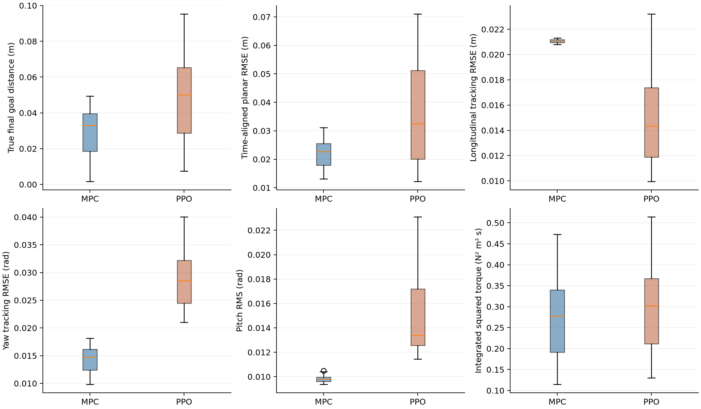
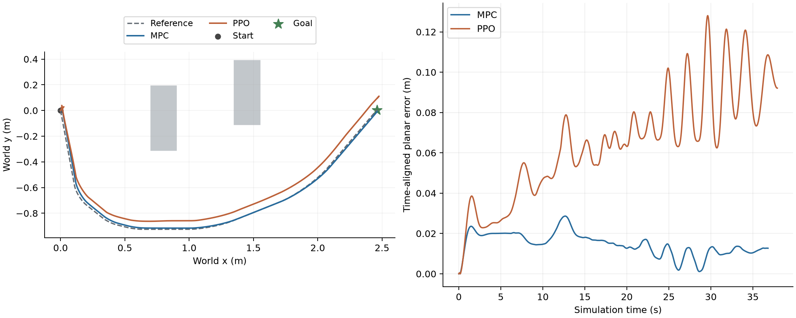
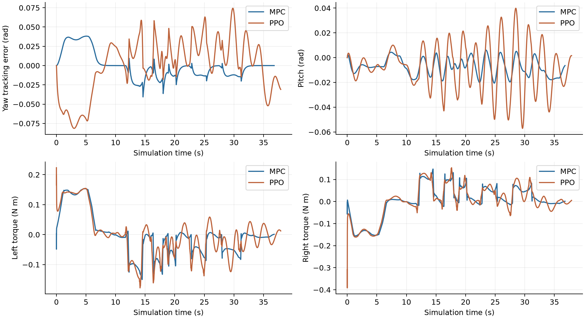
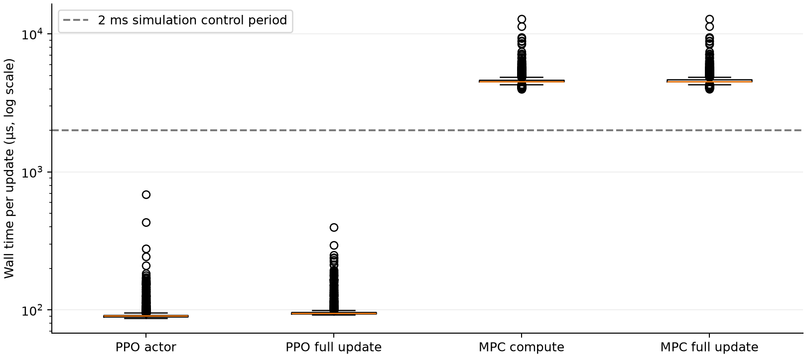

# Controller Comparison

This evaluation measures a shared known-map planner with two wheel-torque controllers, preview MPC and trajectory-conditioned PPO. The selected policy is `d18_selected_full_circle_v2`. The primary dataset contains 100 paired routes with full-circle initial goal bearings.

## Configuration

| Setting | Value |
|---|---|
| Map families | Single wall, staggered obstacles, elbow, wide corridor |
| Cases | 25 per family, 100 per controller |
| Scenario and bearing seed | 518000 |
| Relative goal bearing | Uniform draw over −π to +π |
| Initial pitch / velocity | 0 rad / 0 m/s |
| Physics / control period | 0.001 s / 0.002 s |
| Wheel torque limit | ±2 N·m per wheel |
| Preview | 250 samples, next 0.5 s |
| Timeout | Trajectory duration + 10 s |
| Success | Distance <0.10 m, speed <0.05 m/s, yaw rate <0.10 rad/s, pitch <0.10 rad for 0.50 s after trajectory completion |
| Failure | Physical obstacle contact, map exit or true pitch magnitude >0.70 rad |

The four map generators produce blocked direct routes. Geometric screening requires a complete collision-checked trajectory, path length between 1 and 4 m and duration at most 90 s. Rejected geometric candidates and their reasons are retained in the manifest. Initial headings then establish the full-circle goal bearings for the fixed 100 scenes.

At reset, both methods receive the same estimated initial state and the same trajectory. A SHA-256 over sampled references verifies each pair. The trajectory clock advances at the fixed simulation cadence throughout execution.

The fixed final set had been inspected during development. Training and validation use independently generated scenes and separate seed ranges. Final evaluation uses the frozen actor and unchanged benchmark conditions.

[Case manifest](d18_benchmark_manifest.json) · [Final per-episode data and summary](final_comparison.json)

## Navigation Results

<!-- NAVIGATION_RESULTS_BEGIN -->

| Metric | MPC | PPO |
|---|---:|---:|
| Settled successes | 100/100 | 100/100 |
| Falls / collisions / timeouts | 0 / 0 / 0 | 0 / 0 / 0 |
| Mean true final goal distance (m) | 0.028977 | 0.049744 |
| Mean time-aligned planar RMSE (m) | 0.022198 | 0.036628 |
| Mean longitudinal tracking RMSE (m) | 0.021061 | 0.01483 |
| Mean yaw tracking RMSE (rad) | 0.014402 | 0.028933 |
| Mean pitch RMS (rad) | 0.0098015 | 0.014645 |
| Mean integrated squared torque (N² m² s) | 0.26941 | 0.29492 |
| Mean successful completion time (s), n=100 each | 34.18 | 34.35 |

<!-- NAVIGATION_RESULTS_END -->



Each distribution contains 100 episodes. The plots show medians, interquartile ranges, whiskers extending to 1.5 interquartile ranges and individual outliers. The JSON includes count, mean, median, population standard deviation, p95 and maximum for each metric. Successful completion time uses the successful subset, which contains 100 episodes for each controller in this run.

MPC produced smaller mean planar and heading errors, lower pitch RMS and lower integrated squared torque. PPO produced smaller mean longitudinal position RMSE. The longitudinal coordinate measures cumulative forward displacement, while planar error also reflects how heading errors affect the route through the map.

### Distribution Summary

<!-- NAVIGATION_DISTRIBUTIONS_BEGIN -->

| Metric | Controller | Mean | Median | Std | p95 | Maximum |
|---|---|---:|---:|---:|---:|---:|
| True final goal distance (m) | MPC | 0.028977 | 0.033031 | 0.013329 | 0.045902 | 0.049472 |
| True final goal distance (m) | PPO | 0.049744 | 0.05013 | 0.02457 | 0.091576 | 0.095341 |
| Time-aligned planar RMSE (m) | MPC | 0.022198 | 0.022667 | 0.004212 | 0.028859 | 0.031176 |
| Time-aligned planar RMSE (m) | PPO | 0.036628 | 0.032526 | 0.017821 | 0.068779 | 0.071065 |
| Longitudinal tracking RMSE (m) | MPC | 0.021061 | 0.021043 | 0.0001258 | 0.021254 | 0.0213 |
| Longitudinal tracking RMSE (m) | PPO | 0.01483 | 0.01436 | 0.0032678 | 0.020521 | 0.023221 |
| Yaw tracking RMSE (rad) | MPC | 0.014402 | 0.01472 | 0.0022609 | 0.017543 | 0.018154 |
| Yaw tracking RMSE (rad) | PPO | 0.028933 | 0.028536 | 0.0048473 | 0.036352 | 0.040047 |
| Pitch RMS (rad) | MPC | 0.0098015 | 0.0097974 | 0.00026326 | 0.010253 | 0.01048 |
| Pitch RMS (rad) | PPO | 0.014645 | 0.013377 | 0.0026393 | 0.019304 | 0.023099 |
| Integrated squared torque (N² m² s) | MPC | 0.26941 | 0.27739 | 0.087477 | 0.40733 | 0.47255 |
| Integrated squared torque (N² m² s) | PPO | 0.29492 | 0.30196 | 0.090959 | 0.42917 | 0.5143 |

<!-- NAVIGATION_DISTRIBUTIONS_END -->

### Metric Definitions

For samples at 0.002 s intervals, a scalar tracking error has

$$
\mathrm{RMSE}(e)=\sqrt{\frac{1}{K}\sum_{k=1}^{K}e_k^2}.
$$

- **Longitudinal error** uses estimated forward position minus the absolute forward-position reference.
- **Yaw error** uses wrapped estimated yaw minus reference yaw.
- **Time-aligned planar error** uses the Euclidean distance between true planar pose and reference position at the same elapsed time.
- **Sampled-path distance** uses the nearest sampled reference position and measures offline geometric deviation.
- **Final distance** is reported separately from estimated and true planar position.
- **Pitch RMS and peak pitch** use true pitch. Aggregate peak-pitch statistics summarize each episode's peak.
- **Travelled path length** sums true planar displacement between consecutive samples. The planned/travelled ratio uses the trajectory's arc length as numerator.
- **Absolute torque integral** is $\sum_k(|\tau_L|+|\tau_R|)\Delta t$, in N·m·s.
- **Squared torque integral** is $\sum_k(\tau_L^2+\tau_R^2)\Delta t$, in N²·m²·s.
- **Saturation duration** sums intervals where either requested torque magnitude reaches 1.999999 N·m.

Torque integrals quantify control effort. Mechanical work would additionally require wheel angular velocity. Each time-series metric uses that episode's recorded interval through termination.

### Largest Tracking Difference

Selection maximizes the absolute MPC/PPO difference in time-aligned true planar RMSE, with ties resolved by family and case index. The selected staggered-obstacle case is index 21, with an initial goal bearing of approximately −58.7°.





The route plot transforms both episode-relative traces back into the common world frame. The error plot evaluates each sample against the reference at the same time. Each controller's trace ends at its recorded completion time.

## Computation

<!-- COMPUTE_RESULTS_BEGIN -->

| Computation (µs) | Mean | Median | p95 | p99 | Maximum |
|---|---:|---:|---:|---:|---:|
| PPO actor | 91.89 | 90.58 | 95.84 | 126.2 | 689.6 |
| PPO full update | 96.55 | 95.04 | 99.92 | 139 | 397.2 |
| MPC compute | 4580 | 4519 | 4825 | 5669 | 1.287e+04 |
| MPC full update | 4584 | 4523 | 4829 | 5673 | 1.287e+04 |

<!-- COMPUTE_RESULTS_END -->



The Release C++ executable measures 5,000 updates after 500 warm-up updates with `std::chrono::steady_clock`. A consumed checksum retains the computation. The workload uses deterministic state perturbations and a sampled reference trajectory. Raw samples are saved before distribution summaries are produced.

Actor-only timing covers dense-layer inference. PPO full-update timing includes reference sampling, preprocessing, inference and action scaling. MPC compute includes gradient construction, OSQP and first-command extraction. Its full update additionally includes horizon sampling. The measurement machine, compiler, timing-file hash and actor hash are recorded in the JSON. Simulation, ROS transport and rendering have separate execution costs.

## Policy and Reproduction

The actor contract is `d18_mlp_v1`, with 1256 inputs, two 128-unit tanh layers and two normalized outputs. Its observation contains six current physical quantities in local position/yaw coordinates and 250 five-component future references. Both controller branches receive the same physical reference semantics.

| PPO setting | Selected refinement |
|---|---|
| Library | Stable-Baselines3 PPO / PyTorch |
| Learning rate | 1e-6 |
| Rollout length / vector environments | 2048 / 8 DummyVecEnv |
| Batch size / epochs | 256 / 10 |
| Gamma / GAE lambda | 0.999 / 0.98 |
| Clip range / target KL | 0.2 / 0.03 |
| Entropy coefficient / value coefficient | 0 / 0.5 |
| Maximum gradient norm | 0.5 |
| Final training seed | 329000 |
| Validation seeds | 428000–428039 |
| Selected full-route refinement | 1,500,000 transitions |
| Full-route run wall time, including validation | 1315.825 s |

Training retains 1000 Hz physics and 500 Hz actions. Reward scales for position, velocity, pitch, pitch rate, yaw and yaw rate are `[0.03, 0.20, 0.10, 1.0, 0.10, 0.50]`. Squared normalized tracking errors and `0.02 * squared_torque` form the continuous cost. The control interval scales continuous reward, while success and failure contribute +30 and −20 once per episode.

The selected lineage continues the original trained actor with 500,000 full-circle turning transitions and 1,500,000 full-route transitions. Its final independent validation reached 40/40. Checkpoint manifests record the selected actor and training configuration.

[Actor and export provenance](../artifacts/learning/d18_selected_full_circle_v2/manifest.json) · [Training configuration](../tools/trajectory_learning/config_e_full_tracking.json)

### Generate and Evaluate the Fixed Population

Use the root README build commands first. The generation commands create new output directories. Existing frozen outputs can be reused directly.

```bash
pixi run --frozen python -m tools.trajectory_learning.scenarios \
  --seed 518000 --output artifacts/learning/d18_final_scenarios_v2
pixi run --frozen python -m tools.trajectory_learning.full_circle \
  --source artifacts/learning/d18_final_scenarios_v2 \
  --output artifacts/learning/d18_full_circle_v1 --seed 518000

pixi run --frozen python -m tools.trajectory_learning.benchmark \
  --scenarios artifacts/learning/d18_full_circle_v1 \
  --output artifacts/benchmark/d18_full_circle_retrained_v2/mpc_v2 \
  --method mpc --workers 4
pixi run --frozen python -m tools.trajectory_learning.benchmark \
  --scenarios artifacts/learning/d18_full_circle_v1 \
  --output artifacts/benchmark/d18_full_circle_retrained_v2/ppo \
  --method ppo --workers 4 \
  --actor artifacts/learning/d18_selected_full_circle_v2/actor.txt

mkdir -p artifacts/benchmark/final_release
pixi run --frozen build/trajectory_learning/d18_compute_timing \
  artifacts/learning/d18_selected_full_circle_v2/actor.txt \
  artifacts/benchmark/final_release/compute.csv
pixi run --frozen python -m tools.trajectory_learning.benchmark_report \
  --root artifacts/benchmark/d18_full_circle_retrained_v2
pixi run --frozen python -m tools.trajectory_learning.final_report --refresh-data
```

The saved final run reuses the previously frozen MPC results through a local directory symlink. A fresh reproduction runs both controllers with the commands above. Raw episode files contain metrics JSON, compressed CSV traces and computation samples. The checked-in `docs/data/comparison` bundle contains the selected traces and timing samples used for figure regeneration. Running `final_report` without `--refresh-data` uses that saved bundle and its recorded measurement-machine metadata. The report validates all 100 paired reference hashes before generating tables.

### Runtime Validation

```bash
pixi run --frozen ros2_ws/build/mujoco_backend/trajectory_policy_smoke_test \
  model/Robot1.xml model/known_map.txt \
  artifacts/learning/d18_selected_full_circle_v2/actor.txt --headless \
  --trace artifacts/benchmark/final_release/native_ppo.csv

pixi run --frozen bash
source ros2_ws/install/local_setup.bash
export ROS_DOMAIN_ID=68
python -m tools.trajectory_learning.ros_checks \
  --actor artifacts/learning/d18_selected_full_circle_v2/actor.txt \
  --native-trace artifacts/benchmark/final_release/native_ppo.csv \
  --output artifacts/ros2/final_release/trajectory_ppo
python -m tools.trajectory_learning.ros_fault_checks \
  --actor artifacts/learning/d18_selected_full_circle_v2/actor.txt \
  --output artifacts/ros2/final_release/faults
```

The selected actor completed the native known-map smoke test at 34.842 s with estimated final distance 0.0212100 m. The 36 s ROS run received 36,000 states and 18,000 valid commands with zero contact samples. Its maximum direct-call/ROS difference across the compared channels was 1.10102e-11.

The parity check compares position, speed, pitch, pitch rate, yaw, yaw rate and wheel commands. Fault checks exercise stale state, a stalled clock, non-finite input and actor-load failure. Reset checks verify the new episode's position and yaw origins. [Runtime and regression validation](final_validation.json)

### Recording

The comparison recording reruns `staggered_21` through the production C++ controller bridges. Each 500 Hz update is checked against the saved benchmark trace before the frame is accepted. MuJoCo renders the common camera, obstacles, timed path and goal at 25 fps. Individual videos are 960×1080. The paired video is 1920×1080 at 1× simulated time. The earlier finisher's completed frame remains visible until the second episode ends. Both completed views then remain on screen for two seconds.

The videos use the same camera and scene. Playback follows simulation time at 1× speed.

[Comparison video](../Document/demo/controller_comparison.mp4)
