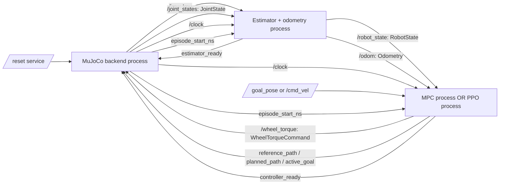
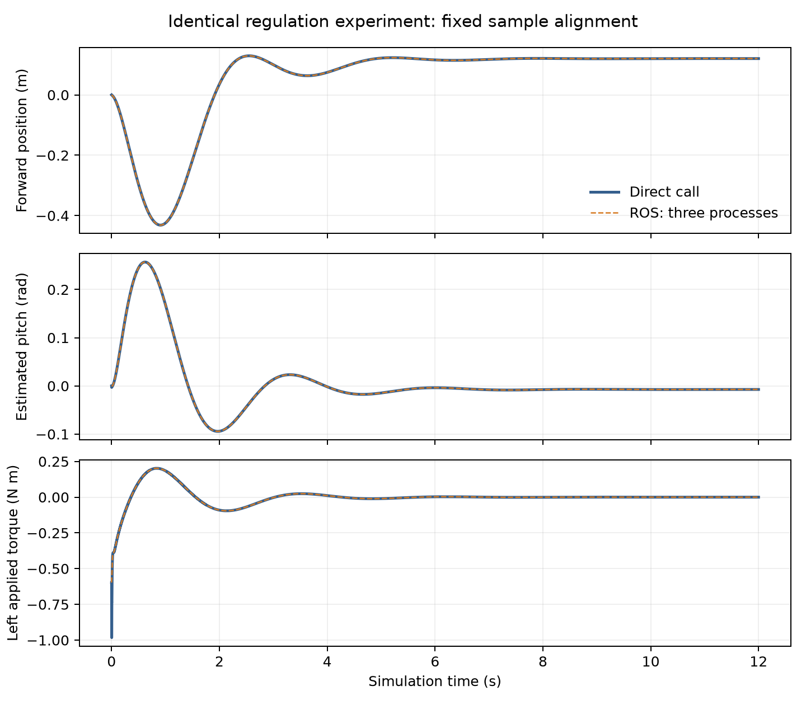

# D17 — ROS 2 System Integration with Thin Adapters

The distributed MPC, PPO and known-map paths are implemented and measured. The direct-call algorithms remain the frozen reference; this document defines the ROS timing and failure-handling contract and its validation limits.

The D11–D16 algorithmic baseline remains frozen. Two packages are added: `robot_msgs` contains only process-boundary interfaces, and `robot_ros` contains separate C++ backend, estimator, MPC and PPO executables plus launch files. It does not move ROS headers into any algorithm package. The adapter builds the unchanged backend source files into a local library because the existing backend package does not export its library; this avoids changing that frozen package's public build interface.

## Process graph



PPO subscribes only to state, odometry, goal, clock and reset-epoch topics. It does not subscribe to paths or velocity references. Its actor and preprocessing are the unchanged learning-policy classes. Separate launch selection starts one torque publisher; no fallback or blended controller exists.

## Timing and ownership

Each process uses one `rclcpp::spin()` single-threaded executor. Backend wall polling wakes the handshake; it is not a physics-frequency timer. The backend publishes the current simulation measurement, waits for the matching estimated state, and on even physics steps also waits for the matching torque. It then applies the command and advances exactly one 1 ms physics step. Odd steps hold the preceding torque. Estimation is driven by timestamped sensor availability. Control is driven by matching state/odometry and simulation-clock progress at even millisecond episode timestamps, never a 2 ms wall timer.

This lockstep configuration deliberately separates deterministic sample alignment from throughput. The ROS run may be slower than real time, particularly because D16 MPC computation already exceeded 2 ms. It does not pretend to characterize an unconstrained asynchronous 500 Hz robot. Missing process/data watchdogs use wall time because stalled simulation time alone cannot expire a watchdog. Simulation-data age and wall pipeline latency are different recorded quantities.

Backend CSV timing starts immediately after sensor publication. It records matching state receipt, command receipt and command application in the backend process's steady clock; these include middleware/callback effects and are not isolated estimator or controller execution costs. It records the measurement timestamp and the command's state-source timestamp as well. D16 computation results are retained separately.

## Independent sensors and synchronization

IMU and encoders are distinct standard topics, stamped at their simulated measurement time. There is no fused perfect-sensor topic. The IMU orientation covariance starts with −1 to indicate that no orientation estimate is supplied; accelerometer and gyro values are the original backend's sensor readings.

Default publication is 1000 Hz for both streams. `encoder_stride` may decimate wheel publication by an integer number of physics steps. The estimator adapter expects the wheel stamp at `epoch + floor((imu_stamp - epoch)/(stride*1 ms)) * stride*1 ms`, buffers streams until that sample arrives, and requires age no greater than `sensor_timeout`. At stride one this is exact-time pairing; at larger strides wheel measurements are explicitly held until the next expected encoder update. There is no hidden interpolation or estimator-equation change. Arbitrarily asynchronous real sensor timing requires a separately validated synchronization policy; integer simulator cadence is the present contract.

Buffers are bounded. Invalid dimensions/names/non-finite samples are rejected, not forwarded to the filter. IMU timestamp drives the original estimator `dt`. The wrapper calls existing `StateEstimator::update()` and `PlanarOdometry::update()` once per paired IMU sample. `/odom` and `/robot_state` share that timestamp; the controller waits for their exact pairing. Odometry position is in `odom`, velocity in the body frame. Unknown covariance remains a limitation of this simple estimator output; no EKF confidence is claimed.

## Reset and time domains

`/reset` is a standard Trigger service. It acknowledges accepting a reset, not immediate completion of distributed readiness. The backend resets physics/commands and publishes a new retained `/episode_start_ns` value greater than the last published sensor time. Estimator and controller independently clear buffers and reset/reconstruct their stateful algorithm objects, then acknowledge that epoch on retained readiness topics. Physics does not resume until both acknowledgments match.

ROS `/clock` is cumulative simulated time and remains monotonic across resets. `RobotState.episode_time` is the local time since the latest physics reset. At reset, a 1 ms simulated epoch boundary separates old/new sensor stamps; subsequent physics time starts at zero. The pure C++ classes receive episode-local timestamps. Standard sensor stamps before the new epoch are rejected, and custom state/command messages carry the epoch explicitly. This makes delayed old messages distinguishable even if the robot returns to the same pose. No wall time is added to simulation time.

This is an explicit reset-time convention rather than assuming resetting MuJoCo also resets other processes. Consumers requiring a backward jump of `/clock` would need a different contract. Goal/trajectory origin and planar pose restart at each epoch. There is no map-to-odom localization transform; known-map coordinates are assumed aligned with the freshly reset odometric frame, as in the direct-call demonstration.

## QoS and freshness

Sensor/state/command topics use reliable keep-last depth eight. Best-effort SensorDataQoS is appropriate for some live sensor streams, but this lossless local lockstep comparison explicitly requires each expected sensor stamp; reliable bounded queues are selected for that reason. The observer uses larger queues to collect measurements. Goal/path/epoch/readiness topics use reliable transient-local depth one where late joiners need the current value. Queue reliability does not replace timestamp freshness checks.

Default `sensor_timeout` and `state_timeout` are 10 ms simulated; command timeout is 10 ms simulated. Controller state wall timeout and backend handshake wall timeout default to 0.5 s. A stale/invalid state or controller exception publishes an invalid zero command. Backend applies zero when the source command is invalid, stale, or the expected handshake expires. Actor load failure exits visibly; it does not construct another controller. `/simulation/pause` is a SetBool service that zeros current actuation and pauses progression.

## References

ROS concepts use the installed Jazzy APIs. Official documentation: [QoS concepts](https://docs.ros.org/en/jazzy/Concepts/Intermediate/About-Quality-of-Service-Settings.html), [Jazzy SensorDataQoS](https://docs.ros.org/en/ros2_packages/jazzy/api/rclcpp/generated/classrclcpp_1_1SensorDataQoS.html), [topics and services](https://docs.ros.org/en/jazzy/How-To-Guides/Topics-Services-Actions.html). API/library behavior is checked against the local RoboStack installation; no dependency version was changed during integration.

## Message contract and runtime configuration

| Topic | Type | Meaning / units |
|---|---|---|
| `/imu` | `sensor_msgs/Imu` | Body/site gyro in rad/s, specific acceleration in m/s²; simulated measurement stamp |
| `/joint_states` | `sensor_msgs/JointState` | Named left/right wheel angles in rad and rates in rad/s; no inferred body pose |
| `/robot_state` | `robot_msgs/RobotState` | Existing forward position/velocity, pitch/rates, wrapped yaw/rate and wheel states; metres, seconds, radians |
| `/odom` | `nav_msgs/Odometry` | Estimated planar pose in `odom`; body-forward velocity and yaw rate; no absolute localization |
| `/wheel_torque` | `robot_msgs/WheelTorqueCommand` | Left then right N·m; generation stamp, source-state stamp, episode epoch and validity |
| `/clock` | `rosgraph_msgs/Clock` | Cumulative simulation time, independent of wall execution speed |
| `/episode_start_ns` | `std_msgs/UInt64` | Current retained episode boundary in cumulative simulation nanoseconds |
| `/estimator_ready`, `/controller_ready` | `std_msgs/UInt64` | Acknowledgment of reset completion for that epoch |
| `/goal_pose` | `geometry_msgs/PoseStamped` | Position goal in `odom`; orientation is not a final-yaw objective |
| `/cmd_vel` | `geometry_msgs/Twist` | In velocity mode only: `linear.x` and `angular.z`; other dimensions ignored |
| `/reference_path`, `/planned_path` | `nav_msgs/Path` | Model-based reference and raw known-map path, for inspection/viewer only |
| `/active_goal` | `geometry_msgs/PoseStamped` | Current goal marker, also in PPO mode |

`RobotState.header.stamp` is the original measurement time, not wall arrival. `episode_time` translates that timestamp to the pure C++ simulation episode. Wheel torque `header.stamp` denotes simulated generation time and `state_stamp` identifies the measurement used. Epoch checking and timestamp freshness are separate: a fresh-looking sample from an old reset must still be rejected.

Parameters are declared by the owning adapter: backend model/viewer/trace/duration, optional known-map description, encoder stride and command/watchdog timeouts; estimator encoder stride and sensor timeout; controller state timeouts, mode and existing trajectory limits; PPO actor path and presentation goal selection. MPC design matrices/gains/horizon are not runtime retuning parameters. The backend still performs the unchanged ±2 N·m physical clamp.

Velocity mode integrates the existing longitudinal/yaw reference origin and constructs moving low-level references through the same preview interface. A 0.5 s simulated `/cmd_vel` timeout clears desired velocity/rate. This is a command adapter, not another velocity feedback controller. Known-map goals use the planner path instead of Twist. Out-of-map or otherwise invalid plans fail visibly and wait for a new goal/reset; there is no automatic replanning or hidden recovery.

ROS paths may contain more samples than the existing viewer's 500-point limit. Only the drawing adapter decimates the displayed path and preserves its endpoint; trajectory samples used by MPC are not altered. The underlying viewer and planner remain unchanged.

## Measured integration results

<!-- ROS_RESULTS_BEGIN -->

| Distributed experiment | Measured result |
|---|---|
| MPC regulation, 12 s | 12000 states, 6000 commands; no fallback |
| Direct/ROS maximum position difference | 1.143e-13 m |
| Direct/ROS maximum pitch difference | 2.414e-13 rad |
| Direct/ROS maximum requested torque difference | 1.376e-10 N·m |
| PPO presentation goals | 4/4 settled; fourth success at 34.648 s |
| PPO peak estimated pitch / applied torque | 0.026646 rad / 0.607607 N·m |
| Known-map estimated / true final error at 44 s | 0.022636 / 0.020560 m |
| Known-map trajectory duration / post-recovery peak pitch | 34.366586 s / 0.019087 rad |
| Known-map obstacle contact samples | 0 |
| 1000 Hz IMU / 500 Hz encoder trial, 2 s | 2000 IMU, 1000 encoder, 1000 commands |
| ROS PPO torque parity, 3 vectors | max error 3.381e-08 N·m |
| Frozen file comparison | 95 files checked; zero changes |

| Backend-observed wall pipeline interval | Mean (µs) | p95 (µs) | Maximum (µs) |
|---|---:|---:|---:|
| Sensor publication → state receipt | 6843.5 | 12161.8 | 18229.7 |
| Sensor publication → command receipt (control steps) | 13715.8 | 18501.5 | 30211.4 |
| Sensor publication → application (all physics steps) | 10447.2 | 18557.7 | 30398.5 |

The regulation run has zero simulated state age and 0–1 ms command age. Wall intervals include DDS delivery, callback scheduling and processing; they are not the D16 controller computation benchmark. Command receipt has one sample per 500 Hz update; application includes held-command steps at 1000 Hz. No hard real-time claim follows from lockstep simulation.

<!-- ROS_RESULTS_END -->



The regulation comparison uses the original −20° XML initialization, estimator initially zero, the same 0.1 m stationary position reference, no disturbance, identical original MPC and 12 simulated seconds. The tolerance was set to `1e-5` for each compared state/torque field before evaluation. The log compares position, velocity, pitch, pitch rate, yaw, yaw rate, requested left/right torque and applied left/right torque. Small differences do not establish mathematical identity for arbitrary ROS scheduling; this result specifically validates the chosen lockstep policy. All three algorithm-bearing processes have distinct PIDs recorded in raw results.

PPO begins upright, using the frozen actor with no stabilization controller. Relative presentation offsets are `(0.4, 0)`, `(0.4, 0.3)`, `(0.4, -0.3)`, `(-0.3, 0)` metres, regenerated from the current estimated pose after settled success or a 15-second goal timeout. Success uses the existing estimated-state condition: distance <0.10 m, |velocity| <0.05 m/s, |yaw rate| <0.10 rad/s, |pitch| <0.10 rad continuously for 0.5 s. All four succeeded. The ROS wrapper checks this at policy updates, whereas the direct presentation checks every physics step; slightly different switch times/next goal coordinates are expected. These four goals do not replace D15/D16 random-goal results.

Known-map execution uses the same scenario file for the original planner and physical obstacle creation. Planning starts at four simulated seconds from the estimated pose, once per accepted goal. The original raw A*, smoothing, trajectory validation, speed limits and preview sampler are called unchanged. No obstacle contacts were logged, and the estimated/true endpoint distance and final forward speed meet the existing distance/speed bounds. Ground truth is read only in the backend diagnostic path. A sampled reference collision check and one successful physical run do not imply general closed-loop collision guarantees.

The original model source is never edited for PPO initialization. The adapter creates a temporary model copy with the existing initial orientation set upright, loads it, then removes the copy. This changes the episode reset pose only; masses, geometry, timestep, actuator limits and source `Robot1.xml` remain unchanged. The model-based experiments use the original startup pose.

## Validation coverage

- Separate IMU/encoder topics, monotonic stamps, exact nominal counts and finite state/torque traces.
- Different sensor rates: 1000 Hz IMU, 500 Hz encoders, 1000 Hz state and 500 Hz controller in a two-second physical run.
- Synthetic reversed wheel-name order preserves left/right meanings; unmatched sensor timestamps block a fused update; non-finite IMU is rejected.
- Stale simulated state, a stopped simulation clock and invalid state produce invalid zero commands.
- Explicit backend clamp test requests −3/+3 N·m, observes −2/+2 N·m and positive initial yaw response. Stale generation timestamps produce zero applied torque.
- Reset clears estimator origins, yaw, planar state, controller runtime and epoch; killing the controller then produces zero-torque fault samples.
- Three exported Python actor vectors passed through ROS preprocessing/inference match the frozen expected action within the preselected 2e-6 N·m tolerance. Missing actor fails visibly.
- Manual goal adapter constructs a trajectory beginning at the supplied **estimated** pose. Twist input produces independent wheel torques in velocity mode. Read-only startup parameters reject runtime mutation rather than accepting an ineffective change.
- An actual launch plus rosbag2 MCAP recording contains all required sensor/state/command/goal/clock topics.

The rosbag run with `--use-sim-time` omits a few initial samples while recorder clock/discovery initializes. The one-second observer still receives all 1000 states; bag topic counts are stored independently. The test verifies recordability, not lossless replay of every startup sample. Start the recorder before launch, wait for topic discovery and nonzero clock before sending one-shot commands, and use the retained epoch for reset interpretation. The earlier wall-indexed bag is preserved separately and is not mislabeled as simulation-indexed recording.

Direct functional regression logs and Python checks are stored in `artifacts/ros2/d17/`. Existing unrelated style checks are not represented as passing. The D17 Release build retains duplicate-library/toolchain warnings; no algorithm or dependency was changed just to remove these warnings.

## Reproduction

Run from the repository root. The local MuJoCo application framework and the selected PPO actor must already be present, as for the direct-call experiments.

```bash
pixi run --frozen bash -c 'cd ros2_ws && colcon build --cmake-args -DCMAKE_BUILD_TYPE=Release'
pixi run --frozen bash
source ros2_ws/install/local_setup.bash
export ROS_DOMAIN_ID=61
ros2 launch robot_ros model_based.launch.py
# Stop that launch before choosing another branch:
ros2 launch robot_ros ppo.launch.py
ros2 launch robot_ros known_map.launch.py
ros2 launch robot_ros simulation.launch.py mode:=known_map viewer:=true duration:=44.0
```

The default finite duration stops physics advancement but leaves nodes alive for inspection/reset; Ctrl-C ends the launch. A stalled-clock controller watchdog may then emit zero-command warnings, which do not indicate an earlier physical-run fault. Rendering is called approximately every 16 physics steps; under slow lockstep execution that is approximately 62.5 Hz **simulated**, not 60 wall frames/s.

Headless measured experiments (run sequentially to avoid contaminating wall timing):

```bash
python tools/ros2/run_experiment.py --mode regulation --duration 12.0 --output artifacts/ros2/d17/regulation
python tools/ros2/run_experiment.py --mode ppo --duration 36.0 --output artifacts/ros2/d17/ppo
python tools/ros2/run_experiment.py --mode known_map --duration 44.0 --output artifacts/ros2/d17/known_map
python tools/ros2/run_experiment.py --stride 2 --duration 2.0 --output artifacts/ros2/d17/encoder_500hz
python tools/ros2/fault_checks.py
python tools/ros2/command_checks.py
python tools/ros2/launch_bag_check.py --output artifacts/ros2/d17/launch_bag_verified
python tools/ros2/report.py
```

Report generation reads saved results and the pre-integration hash snapshot; it never reruns controllers. Existing bag directories are deliberately not overwritten: choose a new output directory when repeating that check. Other experiment commands replace their specified logs, so use another directory to preserve a prior run. The checked-in [result snapshot](ros2_integration_results.json) contains measured values and frozen file hashes; raw CSV/bags remain local generated artifacts.

From another sourced terminal using the same domain:

```bash
ros2 topic list -t
ros2 node list
ros2 topic echo /robot_state --once
ros2 service call /reset std_srvs/srv/Trigger '{}'
ros2 service call /simulation/pause std_srvs/srv/SetBool '{data: true}'
ros2 service call /simulation/pause std_srvs/srv/SetBool '{data: false}'
ros2 topic pub --once /goal_pose geometry_msgs/msg/PoseStamped \
  '{header: {frame_id: odom}, pose: {position: {x: 0.4, y: 0.1}, orientation: {w: 1.0}}}'
ros2 bag record --use-sim-time -o artifacts/ros2/session_bag --topics \
  /imu /joint_states /robot_state /odom /wheel_torque /goal_pose /clock /episode_start_ns
```

Use `mode:=goal` for the obstacle-free goal interface, `mode:=known_map` for map goals, and `mode:=velocity` for periodic Twist input. Regulation ignores goal messages by design. Known-map goals must be free/inside the map; planning failures publish invalid zero commands instead of feeding invalid geometry to MPC. For a custom PPO goal, run `ppo_node` with `goal_sequence:=false` or send `/goal_pose`, which disables its presentation sequence. Only `linear.x` and `angular.z` are used by velocity mode; send modest commands at a sufficient rate and stop publishing to exercise the 0.5 simulated-second timeout.

`ros2 topic hz` observes wall delivery frequency. It is not proof that simulation time advanced at that wall rate. Check consecutive message stamps and episode time to establish simulation cadence. Likewise, rosbag replay is transport inspection here: do not replay recorded torque into a simultaneously running live backend without an explicit experiment design.

## Platform and remaining limits

The tested platform is the same Apple M4/macOS Pixi Release environment as D16. No new dependency was installed. Installed ROS executables include the required custom-message and MuJoCo/GLFW runtime search paths. This does not repair or claim portability for every older direct-call install-tree executable. CMake currently recognizes the local MuJoCo 3.12.0 application layout; another platform/version needs an explicit dependency configuration.

There is no TF broadcaster or robot-state publisher in this milestone. `odom` is the fixed inspection frame; `/odom` carries planar yaw and names `base_link` as its child. It is not a complete 3D attitude TF tree. The IMU frame labels the existing sensor-site axes; no unimplemented transform/localization capability is implied. RViz can inspect the path/pose messages in `odom`; a complete robot visual model and map→odom localization are outside this scope.

Reliable delivery cannot guarantee bounded wall latency. The lockstep handshake intentionally waits for the original compute, and watchdog expiration is an explicit failure path, not a scheduling correction. Arbitrary asynchronous sensor phases, distributed hosts, realtime executors and hardware deadlines have not been validated. ROS timing stays separate from D16 controller-only timing.

The D17 source-hash check covers the existing algorithm/build/configuration inputs captured before integration, including model and actor. Existing algorithms remain unchanged; new ROS adapters and their tools carry ROS dependencies. No controller retuning, PPO training, planner replacement or new robotics algorithm was performed.

## Final requirement review

The complete D17 checklist was reviewed after implementation and measurements. The [validation record](ros2_validation.json) records a Release build of eight packages, 13 existing C++ functional tests, 20 learning/benchmark/audit Python checks and four ROS report checks. Distributed experiments and fault tests are separate from those unit/regression counts. The six-second known-map viewer run also completed path publication and rendering without an exception; it is a rendering integration check, not the full 44-second goal outcome.

| D17 completion requirements | Implemented evidence |
|---|---|
| 1–3: physics ownership, independent sensors, simulation clock | Backend process owns original MuJoCo backend; distinct IMU/JointState and `/clock` topics; cadence traces |
| 4–7: original estimator, synchronization/freshness, state and odometry | Estimator process wraps original classes; same-stamp messages, decimation and missing-stream tests |
| 8–11: original preview MPC, torque transport and stale-data behavior | MPC process calls frozen controller; explicit torque message; clamp, state/command watchdog tests |
| 12: coordinated reset | Epoch/readiness protocol; reset plus controller-loss experiment |
| 13–14: direct comparison and timing | Twelve-second paired regulation; all requested state/torque fields and independent wall/sim-age measurements |
| 15: known-map execution | Original map/planner/trajectory/preview chain; 44-second physical run and contact diagnostics |
| 16–18: separate frozen PPO, estimated input, one actuator source | PPO process, three parity vectors, four goals; exclusive launch and backend publisher guard |
| 19: reproducible bringup | Model-based, PPO and known-map launch files, shared YAML, package-share paths |
| 20–21: direct tests retained and core ROS-independent | Existing 13 C++ functional tests pass; core-source hash comparison and ROS-dependency check |
| 22–23: overview and detailed documentation | Root README, this document, generated result/validation snapshots and learning notes |

The algorithm freeze remains in force. This completes the specified simulation integration scope; it does not add hardware execution, asynchronous deadline guarantees, Nav2, SLAM, local obstacle avoidance or any additional controller.
