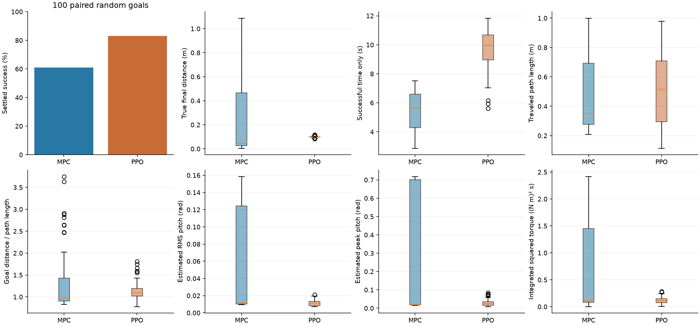
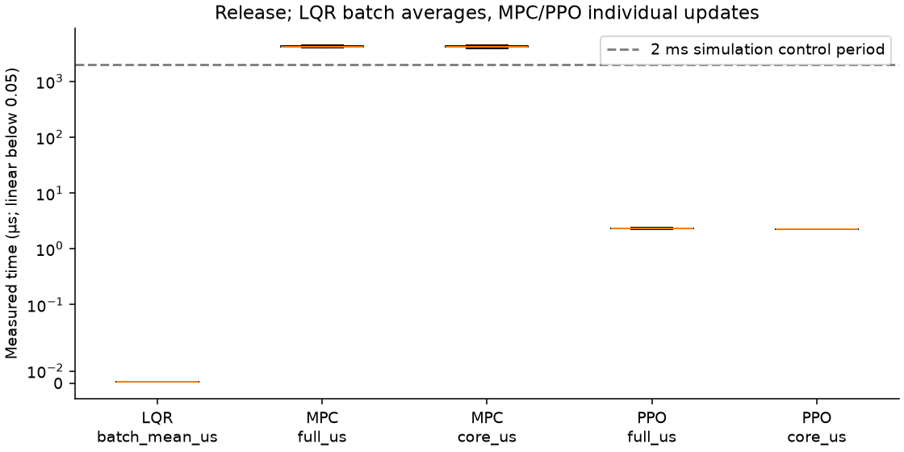
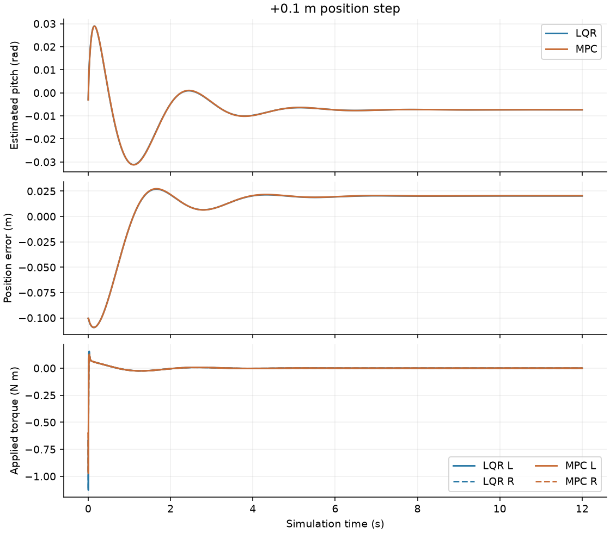
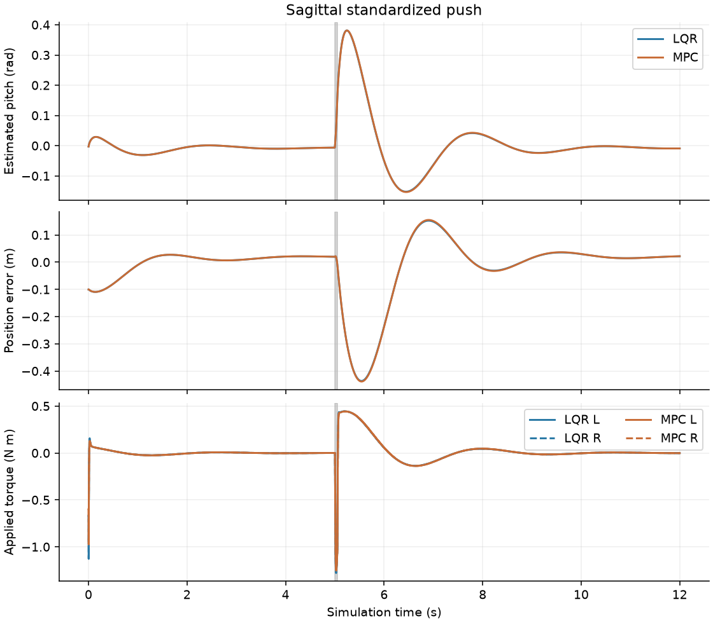
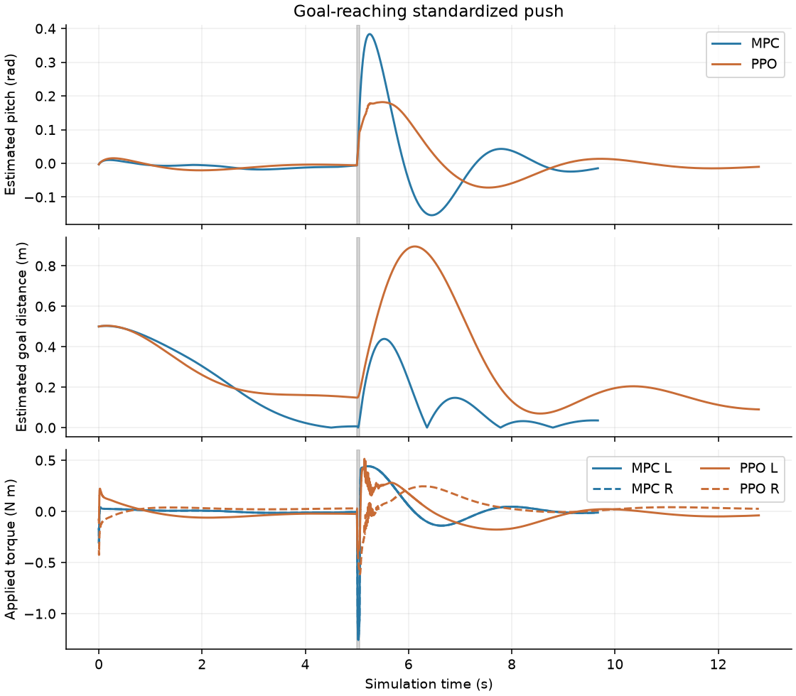
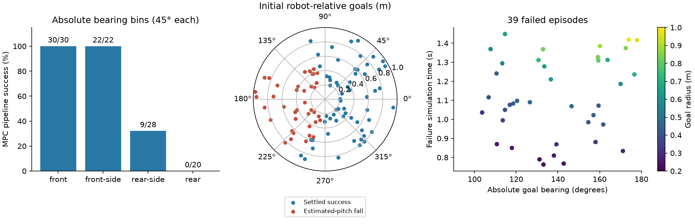
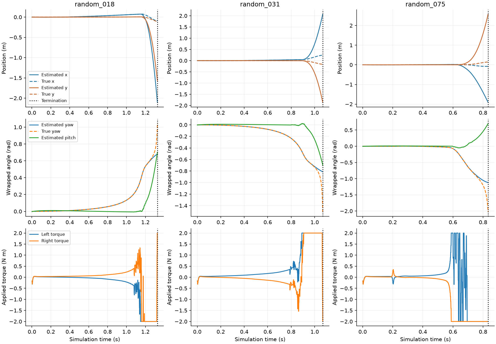

# Obstacle-Free Control Baselines

This reference records sagittal regulation and obstacle-free goal-reaching experiments with the goal-conditioned PPO actor. The current shared-planner navigation results are in [Controller Comparison](CONTROLLER_COMPARISON.md).

## Experimental contract

This layer invokes the production C++ LQR, preview MPC, estimator, odometry, trajectory generator and PPO runtime. No algorithm, actor, normalization, cost, planner, plant parameter or torque constraint is tuned using benchmark outcomes. The new executable is `controller_benchmark`, with Python orchestration and offline analysis under `tools/benchmark/`.

The complete configuration is [tools/benchmark/config.json](../tools/benchmark/config.json). A copy is saved before execution with SHA-256 hashes of model, actor, algorithm sources and benchmark sources, generated scenarios, compiler/platform metadata and the Pixi lockfile hash. `freeze_check.json` compares the hashed inputs after execution. The pre-development baseline is separately saved under `artifacts/benchmark/frozen_baseline.json` so adding the benchmark executable can be distinguished from changing an existing algorithm.

### Shared conditions

| Setting | Frozen value |
|---|---|
| Physics / estimator / odometry | 1000 Hz |
| Controller | 500 Hz, zero-order hold for two physics steps |
| Actuator limit | ±2 N·m per wheel |
| Nominal reset | Upright, stationary, initial yaw zero, estimated local pose zero |
| Episode timeout, goal reaching | 15 s |
| Goal radius distribution | Uniform radius 0.2–1.0 m, not uniform area |
| Goal bearing | Uniform over [−π,π] |
| Random generator | NumPy `default_rng`, seed 216000 |
| Main random episodes | 100 per method, exactly paired coordinates |
| Fixed direction checks | Eight per method |
| Success region | Estimated distance <0.10 m, |v| <0.05 m/s, |yaw rate| <0.10 rad/s, |pitch| <0.10 rad |
| Success hold | 0.50 consecutive simulation seconds |
| Common fall criterion | |estimated pitch| >0.7 rad |
| Sagittal duration | 12 s |
| Sagittal position / pitch settling bands | 0.01 m / 0.02 rad |
| Obstacle-free trajectory | Existing Hermite generator; 0.18 m/s, 0.08 m/s² |
| Disturbance | −50 N on `base_body`, current body-local X, [5.00,5.05) s |
| Timing | Release; 500 discarded updates followed by 5000 measured updates |

The one generated scenario manifest is reused for both methods. All nominal starts have yaw zero, so the sampled robot-frame offsets initially coincide with world-frame offsets. The target is added to the current estimated pose. There is no simulator-truth initialization of controller state. A temporary upright XML copy changes only the initial orientation; the checked-in −20° model and all physical parameters remain unchanged.

The C++ backend exposes diagnostic world x/y/yaw but not true pitch through its frozen public API. The benchmark uses estimated pitch consistently for pitch metrics and the common fall criterion. These should not be mislabeled as the true-pitch statistics from the Python policy evaluation. A physically fallen/contacting configuration not detected by that criterion is outside this classifier's guarantees. No backend interface was expanded to improve benchmark access.

## Comparison groups

### A: sagittal regulation

LQR and MPC each receive ±0.05, ±0.10 and ±0.20 m position steps, with stationary velocity/pitch/yaw references. An additional +0.10 m trial receives the standardized force pulse. This produces seven trials per method. LQR uses the gains already embedded in its existing smoke test; MPC uses its frozen six-state two-input model. No unrelated 5 m saturation experiment is included.

Each trial runs to 12 s unless the common estimated-pitch fall criterion is met. Goal-region success labels are not the primary sagittal metric; the much tighter 0.01 m position settling definition is reported separately. PD is excluded from this position comparison because it only stabilizes pitch.

### B: obstacle-free 2D goals

The main result uses 100 random pairs. Eight fixed directions are additional checks, not pooled into the main random success percentage: (±0.5,0), (0,±0.5), and all four (±0.5,±0.5) diagonals.

MPC creates one trajectory from the current estimated pose to the goal at episode start and samples all 250 future references every control update. It preserves the existing forward-position origin convention, does not invoke A*, and does not replan or add cross-track feedback when the reference ends. PPO receives only the six normalized estimated-state/goal features and directly produces independent wheel torques. Neither branch uses a different startup controller.

The full-circle distribution can reveal limitations that a forward-oriented presentation sequence does not. Poor results do not authorize retuning the trajectory, extending one method's timeout, changing success thresholds, selecting favorable goals or adding another controller.

### C: disturbed 2D goals

Each of the eight fixed directions is run both clean and with the pulse, for both MPC and PPO: 32 episodes. Timing is fixed at 5 s, not tied to an internal controller event. The body-local force direction rotates with the robot, following the existing disturbance API; it is not a fixed global vector. That is the same external disturbance *definition* for both methods, even if their headings at 5 s differ.

Clean and pushed C trials remain active through at least pulse end plus the 0.50 s hold interval, even if they previously entered the goal region. This ensures the pulse can be evaluated after early arrival and applies the same observation window rule to matched clean trials. Termination still occurs on a detected fall or at the common timeout.

Post-disturbance goal recovery means achieving the common settled goal condition after the pulse. It does not mean returning to an internal nominal trajectory or to an exact unperturbed state. Sagittal recovery has a different explicit definition below.

### D: computation

The original benchmark ran isolated LQR, MPC and PPO processes sequentially after all parallel functional jobs finished. The final audit retains those raw files and replaces only displayed LQR timing with a separate batched measurement described below. Each uses a small +0.10 m task over 11 simulation seconds to obtain 5500 controller updates; the first 500 are discarded. LQR uses its position reference; MPC uses the normal point-to-point trajectory; PPO sees the goal. The workload and scope differences are explicit. Construction of controller matrices, actor loading, simulator stepping, estimator updates, trace writing and console I/O are outside the timed interval.

`std::chrono::steady_clock` measures microseconds:

| Field | Exact scope |
|---|---|
| LQR `batch_mean_us` | Production `compute_command()` with indexed input loads/output stores; total batch wall time divided by calls; original quantized `full_us`/`core_us` preserved in raw files |
| MPC `core_us` | Existing `compute_command(state,horizon)`: gradient update, OSQP solve and first-command extraction |
| MPC `full_us` | Future-reference horizon construction plus that command call |
| PPO `full_us` | Existing `policy.torque()`: observation construction, normalization, MLP inference, clipping/scaling and command assignment |
| PPO `core_us` | A separately timed actor call with an already constructed observation |

The frozen MPC API does not expose its OSQP object's internal timer. `core_us` is **not solver-only time**. Adding instrumentation to controller internals solely for the benchmark would violate the architecture freeze. PPO actor-only timing is a second call after the full call; its data/weights are warm. All methods have a substantial warm-up, but sub-microsecond measurements still include clock overhead and ordinary operating-system variability. Neither maximum observed time nor lack of deadline misses establishes a worst-case real-time bound.

Raw update samples remain in the compute CSV files. Reports include mean, median, p95, p99 and maximum; timing plots use a symmetric-log axis with a linear region below 0.05 µs and suppress boxplot outlier markers only for legibility. Compare to 2000 µs as a simulation scheduling period, not a hard real-time certification. Machine and compiler strings are saved in `machine.json`; all controller packages are checked for `CMAKE_BUILD_TYPE=Release` before execution.

The recorded machine is an Apple M4 running macOS 27.0 arm64, with `/usr/bin/c++` reporting Apple Clang 17.0.0. Relevant dependencies are MuJoCo 3.12.0, Eigen 5.0.1, OsqpEigen 0.11.2, GLFW 3.5.1 and ament_cmake 2.5.6. The resolved environment's lockfile hash is recorded alongside these values. Functional runs may share CPU resources; only the separate serial compute runs are used to discuss computation cost.

### E: known-map capability

<a id="known-map-capability"></a>

The existing known-map navigation smoke test remains a separately tested model-based capability, not a PPO/MPC obstacle benchmark. Its pipeline is occupancy grid → footprint/safety inflation → octile A* → line-of-sight simplification → collision-checked smoothing or stopped turns → curvature/yaw-rate speed limits → forward/backward acceleration passes → timed trajectory → preview MPC.

The shared [scenario file](../model/known_map.txt) defines both occupancy and physical obstacle geometry. Its 84×64 grid has 0.05 m resolution, origin (−1.0,−1.6) m, goal (2.4,0) m and a wall spanning x=[1.0,1.3], y=[−0.4,0.4] m, height 0.6 m. The direct route is obstructed. Planner reference collision checking does not prove universal closed-loop safety, especially because MPC does not directly penalize cross-track error.

The final Release regression output and measured scenario values are retained with the benchmark artifacts. No PPO obstacle run is performed: the selected PPO has neither obstacle observations nor obstacle training.

This existing demonstration retains its original MPC recovery phase before planning. Its total simulation time includes that phase, and its reported maximum pitch is explicitly measured after recovery. It is not pooled with the upright-reset Group B statistics. `known_map.json` retains the exact success line extracted from the separately saved `functional_tests.log`.

<!-- KNOWN_MAP_RESULT_BEGIN -->

| Known-map capability metric | Measured value |
| --- | --- |
| Total simulated duration (including startup recovery) | 43.37 s |
| estimated goal error | 0.02264 m |
| debug true goal error | 0.02056 m |
| max torque | 0.5145 N·m |
| max pitch after recovery | 0.01909 rad |
| max odometry error | 0.00351 m |

<!-- KNOWN_MAP_RESULT_END -->

## Metric definitions

Traces record every 1 ms physics interval. Row time is the interval's end; torques/force are those held during that interval, while state and diagnostic position are sampled after the step. The control timer is present on alternate rows and −1 on held-command-only rows. No full reference horizon is dumped into the trace.

For scalar samples e_i over M uniformly spaced samples:

```text
RMSE(e) = sqrt((1/M) sum_i e_i²)
position error e_i = estimated_forward_position_i - position_reference
final absolute position error = |e_M|
pitch RMSE = sqrt(mean(estimated_pitch²))
velocity RMSE = sqrt(mean(estimated_forward_velocity²))  [stationary sagittal task]
```

Position settling time is the start of the final uninterrupted interval inside |e|<0.01 m that lasts at least 0.50 s through trial end. If the trial never establishes that suffix, the value is null. This is stronger than a one-time threshold crossing and is defined only over the recorded finite episode. Short early-fall records cannot establish later recovery.

Post-push pitch recovery time is measured from pulse end to the end of the first consecutive 0.50 s interval with |pitch|<0.02 rad. Sagittal disturbance recovery additionally requires |position error|<0.01 m during that interval. Missing recovery is null, not zero. Goal-reaching disturbance recovery is pulse-end to successful settled-goal termination, reported only for successful episodes.

For applied wheel torques and dt=0.001 s:

```text
absolute torque integral = sum_i (|tau_L_i| + |tau_R_i|) dt
squared torque integral  = sum_i (tau_L_i² + tau_R_i²) dt
saturation duration = sum_i 1[max(|tau_L_i|,|tau_R_i|) >= 2 - 1e-6] dt
maximum requested torque = max over both requested wheel commands
maximum applied torque = max over both backend-clamped wheel commands
```

The two-wheel saturation duration counts elapsed time once even if both wheels saturate. Requested and applied commands differ for unconstrained LQR and can differ by solver tolerance for MPC. The evaluation wrapper computes the same scalar clamp as the unchanged backend to log applied torque; it still passes the original request to that backend. The absolute integral has units N·m·s and the squared integral has units (N·m)²·s. Neither is mechanical energy; that would require wheel angular velocity in the power calculation.

Goal metrics:

```text
estimated distance = hypot(goal_x - estimated_x, goal_y - estimated_y)
true distance      = hypot(goal_x - true_x, goal_y - true_y)  [evaluation only]
traveled length    = sum ||true_position_i - true_position_(i-1)||
efficiency ratio   = initial straight-line goal distance / traveled length
```

The initial true planar position is zero in this fixed upright reset. The path integral includes the first displacement from zero. Zero-length paths have a null ratio. A ratio above one can arise when a successful robot stops before reaching the mathematical goal center; a failure with little travel can also have a large ratio. Success, endpoint distance and path length must accompany it.

For C, peak pitch is the maximum absolute estimated pitch from pulse start onward. Goal-distance increase is `max(0, max(post-push estimated distance) - last pre-push estimated distance)`. Additional path/effort is pushed minus clean for the same fixed goal and controller. Episodes can terminate at different times, so these deltas include the effect of differing completion/timeout duration; they are not fixed-horizon causal energy estimates and may be negative.

Success, fall and timeout counts retain every completed episode. Mean final distance, path, effort and pitch include unsuccessful episodes. Successful time and recovery distributions exclude undefined cases and display their defined sample count. Population standard deviation uses denominator n. Percentiles use NumPy's default linear interpolation. Mean episode RMS is not pooled time-weighted RMS; mean path efficiency is not the ratio of the two means.

PPO training return is not reconstructed in this C++ comparison: reward is a training-side diagnostic, absent from the production policy interface. Historical PPO returns are preserved in learning artifacts. No reward scalar is compared with an MPC objective.

## Generated results

These tables are regenerated from compressed raw traces by `python -m tools.benchmark.report`. Executable failures, missing traces, non-finite data, invalid cadence or missing timing samples cause report generation to fail rather than silently drop unfavorable episodes.

<!-- BENCHMARK_RESULTS_BEGIN -->

### Sagittal regulation: LQR and MPC


| Trial | Method | Position RMSE (m) | Final error (m) | Max pitch (rad) | ∫τ²dt | Saturation (s) | Recovery (s) |
| --- | --- | --- | --- | --- | --- | --- | --- |
| -0.20 m | LQR | 0.05484 | 0.02025 | 0.06313 | 0.05093 | 0.002 | — |
| -0.20 m | MPC | 0.05495 | 0.02041 | 0.06299 | 0.04339 | 0 | — |
| -0.10 m | LQR | 0.03284 | 0.02025 | 0.03248 | 0.01342 | 0 | — |
| -0.10 m | MPC | 0.03295 | 0.02041 | 0.03242 | 0.01091 | 0 | — |
| -0.05 m | LQR | 0.02381 | 0.02025 | 0.01725 | 0.003554 | 0 | — |
| -0.05 m | MPC | 0.02394 | 0.02041 | 0.01721 | 0.002893 | 0 | — |
| +0.05 m | LQR | 0.02171 | 0.02025 | 0.02174 | 0.004265 | 0 | — |
| +0.05 m | MPC | 0.02185 | 0.02041 | 0.02182 | 0.003606 | 0 | — |
| +0.10 m | LQR | 0.02937 | 0.02025 | 0.03116 | 0.01477 | 0 | — |
| +0.10 m | MPC | 0.02947 | 0.02041 | 0.03124 | 0.01226 | 0 | — |
| +0.20 m | LQR | 0.05055 | 0.02025 | 0.05962 | 0.05379 | 0.002 | — |
| +0.20 m | MPC | 0.05062 | 0.02041 | 0.05952 | 0.04616 | 0 | — |
| +0.10 m + pulse | LQR | 0.1106 | 0.02151 | 0.3812 | 0.3767 | 0 | — |
| +0.10 m + pulse | MPC | 0.1113 | 0.02178 | 0.3811 | 0.3713 | 0 | — |


### Common obstacle-free goal reaching: 100 paired random goals


| Method | Success | Falls | Timeouts | Final true distance, mean (m) | Successful time, mean (s) | Path length, mean (m) | RMS pitch, mean (rad) | ∫τ²dt, mean |
| --- | --- | --- | --- | --- | --- | --- | --- | --- |
| MPC | 61/100 | 39 | 0 | 0.2548 | 5.485 | 0.4804 | 0.05766 | 0.6817 |
| PPO | 83/100 | 0 | 17 | 0.09897 | 9.664 | 0.5119 | 0.01135 | 0.1108 |

| Method | Estimated final distance, mean (m) | Efficiency ratio, mean | Pitch, worst (rad) | Torque, worst (N·m) | ∫|τ|dt, mean | Saturation, mean (s) |
| --- | --- | --- | --- | --- | --- | --- |
| MPC | 1.138 | 1.264 | 0.7183 | 2 | 0.8387 | 0.07664 |
| PPO | 0.0979 | 1.122 | 0.08445 | 0.9142 | 1.085 | 0 |


### Disturbed goal reaching: eight paired fixed directions


| Method | Task success | Falls | Pulse exposed | Failures before pulse | Peak post-push pitch, worst (rad) | Goal-distance increase, worst (m) | Successful recovery, mean (s) | Additional path, mean (m) | Additional ∫τ²dt, mean |
| --- | --- | --- | --- | --- | --- | --- | --- | --- | --- |
| MPC | 5/8 | 3 | 5 | 3 | 0.3835 | 0.4322 | 4.614 | 0.7734 | 0.2214 |
| PPO | 8/8 | 0 | 8 | 0 | 0.1894 | 0.7603 | 7.827 | 1.821 | 0.2143 |


### Isolated Release computation: microseconds per update


| Method / scope | Samples | Mean | Median | p95 | p99 | Maximum |
| --- | --- | --- | --- | --- | --- | --- |
| LQR / batch_mean_us | 2000 | 0.001351 | 0.001337 | 0.001422 | 0.001548 | 0.002445 |
| MPC / full_us | 5000 | 4220 | 4220 | 4411 | 4668 | 5583 |
| MPC / core_us | 5000 | 4218 | 4219 | 4408 | 4666 | 5581 |
| PPO / full_us | 5000 | 2.304 | 2.292 | 2.375 | 2.417 | 7.042 |
| PPO / core_us | 5000 | 2.262 | 2.25 | 2.292 | 2.375 | 9.75 |

LQR entries describe 2000 batch averages, each over 100000 production calls, after 100 warm-up batches. They include indexed input loads and output stores. Their p99/maximum are batch-average statistics, not single-call latency bounds. MPC/PPO retain the original individual-update measurements.


### Full scalar distributions


Population standard deviation is used. Null values are excluded only for conditionally defined metrics; their count is shown. All other episode statistics retain failures.


#### sagittal: LQR


| Metric | Defined count | Mean | Median | Std | p95 | Maximum |
| --- | --- | --- | --- | --- | --- | --- |
| absolute_torque | 7 | 0.2797 | 0.128 | 0.3667 | 0.886 | 1.164 |
| applied_torque | 7 | 1.247 | 1.132 | 0.5364 | 2 | 2 |
| disturbance_recovery_time | 0 | — | — | — | — | — |
| duration | 7 | 12 | 12 | 1.776e-15 | 12 | 12 |
| estimated_final_distance | 7 | 0.02043 | 0.02025 | 0.0004389 | 0.02113 | 0.0215 |
| fall | 7 | 0 | 0 | 0 | 0 | 0 |
| maximum_pitch | 7 | 0.08665 | 0.03248 | 0.1213 | 0.2858 | 0.3812 |
| path_efficiency | 7 | 0.5791 | 0.604 | 0.2441 | 0.847 | 0.8829 |
| path_length | 7 | 0.3641 | 0.1806 | 0.457 | 1.123 | 1.462 |
| pitch_recovery_time | 1 | 3.687 | 3.687 | 0 | 3.687 | 3.687 |
| pitch_rmse | 7 | 0.02115 | 0.01098 | 0.02447 | 0.06142 | 0.08066 |
| position_final_error | 7 | 0.02043 | 0.02025 | 0.000443 | 0.02113 | 0.02151 |
| position_rmse | 7 | 0.04625 | 0.03284 | 0.02881 | 0.0939 | 0.1106 |
| position_settling_time | 0 | — | — | — | — | — |
| post_push_distance_increase | 1 | 0.4045 | 0.4045 | 0 | 0.4045 | 0.4045 |
| post_push_peak_pitch | 1 | 0.3812 | 0.3812 | 0 | 0.3812 | 0.3812 |
| requested_torque | 7 | 1.304 | 1.132 | 0.6184 | 2.202 | 2.203 |
| saturation_duration | 7 | 0.0005714 | 0 | 0.0009035 | 0.002 | 0.002 |
| squared_torque | 7 | 0.07391 | 0.01477 | 0.1251 | 0.2798 | 0.3767 |
| straight_line_distance | 7 | 0.1143 | 0.1 | 0.05803 | 0.2 | 0.2 |
| success | 7 | 1 | 1 | 0 | 1 | 1 |
| time_to_success | 7 | 12 | 12 | 1.776e-15 | 12 | 12 |
| timeout | 7 | 0 | 0 | 0 | 0 | 0 |
| true_final_distance | 7 | 0.02028 | 0.02049 | 0.0007162 | 0.02121 | 0.0214 |
| truth_inside_goal | 7 | 1 | 1 | 0 | 1 | 1 |
| velocity_rmse | 7 | 0.07103 | 0.03714 | 0.08455 | 0.2117 | 0.2731 |


#### sagittal: MPC


| Metric | Defined count | Mean | Median | Std | p95 | Maximum |
| --- | --- | --- | --- | --- | --- | --- |
| absolute_torque | 7 | 0.2787 | 0.1267 | 0.3685 | 0.8879 | 1.168 |
| applied_torque | 7 | 1.146 | 0.9767 | 0.5338 | 1.897 | 1.899 |
| disturbance_recovery_time | 0 | — | — | — | — | — |
| duration | 7 | 12 | 12 | 1.776e-15 | 12 | 12 |
| estimated_final_distance | 7 | 0.0206 | 0.02041 | 0.0004758 | 0.02136 | 0.02177 |
| fall | 7 | 0 | 0 | 0 | 0 | 0 |
| maximum_pitch | 7 | 0.08662 | 0.03242 | 0.1213 | 0.2857 | 0.3811 |
| path_efficiency | 7 | 0.5765 | 0.6012 | 0.2437 | 0.8446 | 0.8806 |
| path_length | 7 | 0.367 | 0.1817 | 0.462 | 1.134 | 1.477 |
| pitch_recovery_time | 1 | 3.697 | 3.697 | 0 | 3.697 | 3.697 |
| pitch_rmse | 7 | 0.0212 | 0.011 | 0.02457 | 0.06162 | 0.08094 |
| position_final_error | 7 | 0.0206 | 0.02041 | 0.0004804 | 0.02137 | 0.02178 |
| position_rmse | 7 | 0.04644 | 0.03295 | 0.02898 | 0.09441 | 0.1113 |
| position_settling_time | 0 | — | — | — | — | — |
| post_push_distance_increase | 1 | 0.4065 | 0.4065 | 0 | 0.4065 | 0.4065 |
| post_push_peak_pitch | 1 | 0.3811 | 0.3811 | 0 | 0.3811 | 0.3811 |
| requested_torque | 7 | 1.146 | 0.9767 | 0.5338 | 1.897 | 1.899 |
| saturation_duration | 7 | 0 | 0 | 0 | 0 | 0 |
| squared_torque | 7 | 0.07007 | 0.01226 | 0.1241 | 0.2737 | 0.3713 |
| straight_line_distance | 7 | 0.1143 | 0.1 | 0.05803 | 0.2 | 0.2 |
| success | 7 | 1 | 1 | 0 | 1 | 1 |
| time_to_success | 7 | 12 | 12 | 1.776e-15 | 12 | 12 |
| timeout | 7 | 0 | 0 | 0 | 0 | 0 |
| true_final_distance | 7 | 0.02044 | 0.02061 | 0.0006219 | 0.02123 | 0.02139 |
| truth_inside_goal | 7 | 1 | 1 | 0 | 1 | 1 |
| velocity_rmse | 7 | 0.07118 | 0.03716 | 0.08506 | 0.2127 | 0.2746 |


#### goal_reaching: MPC


| Metric | Defined count | Mean | Median | Std | p95 | Maximum |
| --- | --- | --- | --- | --- | --- | --- |
| absolute_torque | 100 | 0.8387 | 0.9098 | 0.2489 | 1.14 | 1.375 |
| applied_torque | 100 | 1.018 | 0.473 | 0.7951 | 2 | 2 |
| duration | 100 | 3.782 | 4.09 | 2.364 | 7.328 | 7.515 |
| estimated_final_distance | 100 | 1.138 | 0.04352 | 1.395 | 3.179 | 3.505 |
| fall | 100 | 0.39 | 0 | 0.4877 | 1 | 1 |
| maximum_pitch | 100 | 0.2856 | 0.01977 | 0.3346 | 0.7065 | 0.7183 |
| path_efficiency | 100 | 1.264 | 0.9592 | 0.6175 | 2.654 | 3.747 |
| path_length | 100 | 0.4804 | 0.3493 | 0.2511 | 0.9614 | 0.9993 |
| pitch_rmse | 100 | 0.05766 | 0.01168 | 0.05926 | 0.1491 | 0.1585 |
| requested_torque | 100 | 1.018 | 0.473 | 0.7951 | 2 | 2 |
| saturation_duration | 100 | 0.07664 | 0 | 0.09938 | 0.2554 | 0.3 |
| squared_torque | 100 | 0.6817 | 0.1144 | 0.7724 | 1.923 | 2.416 |
| straight_line_distance | 100 | 0.5455 | 0.5515 | 0.2334 | 0.9354 | 0.9805 |
| success | 100 | 0.61 | 1 | 0.4877 | 1 | 1 |
| time_to_success | 61 | 5.485 | 5.638 | 1.302 | 7.342 | 7.515 |
| timeout | 100 | 0 | 0 | 0 | 0 | 0 |
| true_final_distance | 100 | 0.2548 | 0.04575 | 0.3167 | 0.935 | 1.087 |
| truth_inside_goal | 100 | 0.61 | 1 | 0.4877 | 1 | 1 |


#### goal_reaching: PPO


| Metric | Defined count | Mean | Median | Std | p95 | Maximum |
| --- | --- | --- | --- | --- | --- | --- |
| absolute_torque | 100 | 1.085 | 1.055 | 0.3736 | 1.629 | 2.304 |
| applied_torque | 100 | 0.5136 | 0.4892 | 0.2017 | 0.8605 | 0.9142 |
| duration | 100 | 10.57 | 10.29 | 2.349 | 15 | 15 |
| estimated_final_distance | 100 | 0.0979 | 0.09712 | 0.00548 | 0.108 | 0.1166 |
| fall | 100 | 0 | 0 | 0 | 0 | 0 |
| maximum_pitch | 100 | 0.0289 | 0.02512 | 0.01693 | 0.06912 | 0.08445 |
| path_efficiency | 100 | 1.122 | 1.097 | 0.1975 | 1.554 | 1.805 |
| path_length | 100 | 0.5119 | 0.5168 | 0.2443 | 0.895 | 0.9776 |
| pitch_rmse | 100 | 0.01135 | 0.01084 | 0.003335 | 0.01818 | 0.02097 |
| requested_torque | 100 | 0.5136 | 0.4892 | 0.2017 | 0.8605 | 0.9142 |
| saturation_duration | 100 | 0 | 0 | 0 | 0 | 0 |
| squared_torque | 100 | 0.1108 | 0.1098 | 0.05527 | 0.2031 | 0.2833 |
| straight_line_distance | 100 | 0.5455 | 0.5515 | 0.2334 | 0.9354 | 0.9805 |
| success | 100 | 0.83 | 1 | 0.3756 | 1 | 1 |
| time_to_success | 83 | 9.664 | 9.973 | 1.344 | 11.57 | 11.83 |
| timeout | 100 | 0.17 | 0 | 0.3756 | 1 | 1 |
| true_final_distance | 100 | 0.09897 | 0.09848 | 0.005747 | 0.1081 | 0.1166 |
| truth_inside_goal | 100 | 0.7 | 1 | 0.4583 | 1 | 1 |


#### disturbance: MPC


| Metric | Defined count | Mean | Median | Std | p95 | Maximum |
| --- | --- | --- | --- | --- | --- | --- |
| absolute_torque | 8 | 1.418 | 1.46 | 0.4174 | 1.88 | 1.88 |
| additional_absolute_torque | 8 | 0.6112 | 0.9201 | 0.475 | 1.023 | 1.03 |
| additional_path_length | 8 | 0.7734 | 1.185 | 0.6 | 1.275 | 1.278 |
| additional_squared_torque | 8 | 0.2214 | 0.3473 | 0.1715 | 0.3596 | 0.3605 |
| applied_torque | 8 | 1.555 | 1.307 | 0.345 | 2 | 2 |
| disturbance_recovery_time | 5 | 4.614 | 4.619 | 0.006369 | 4.619 | 4.619 |
| duration | 8 | 6.469 | 9.656 | 4.127 | 9.669 | 9.669 |
| estimated_final_distance | 8 | 1.163 | 0.07487 | 1.429 | 3.043 | 3.043 |
| failure_before_pulse | 8 | 0.375 | 0 | 0.4841 | 1 | 1 |
| fall | 8 | 0.375 | 0 | 0.4841 | 1 | 1 |
| maximum_pitch | 8 | 0.504 | 0.3821 | 0.1618 | 0.7158 | 0.7158 |
| path_efficiency | 8 | 0.9417 | 0.3669 | 0.8205 | 2.112 | 2.112 |
| path_length | 8 | 1.283 | 1.81 | 0.7483 | 1.927 | 1.927 |
| pitch_recovery_time | 5 | 3.693 | 3.701 | 0.009798 | 3.701 | 3.701 |
| pitch_rmse | 8 | 0.1022 | 0.09018 | 0.01779 | 0.1303 | 0.1373 |
| post_push_distance_increase | 5 | 0.4133 | 0.417 | 0.01208 | 0.4292 | 0.4322 |
| post_push_peak_pitch | 5 | 0.3787 | 0.3808 | 0.00384 | 0.383 | 0.3835 |
| pulse_exposed | 8 | 0.625 | 1 | 0.4841 | 1 | 1 |
| requested_torque | 8 | 1.555 | 1.307 | 0.345 | 2 | 2 |
| saturation_duration | 8 | 0.0645 | 0 | 0.08338 | 0.177 | 0.177 |
| squared_torque | 8 | 0.8219 | 0.4705 | 0.4999 | 1.487 | 1.487 |
| straight_line_distance | 8 | 0.6036 | 0.6036 | 0.1036 | 0.7071 | 0.7071 |
| success | 8 | 0.625 | 1 | 0.4841 | 1 | 1 |
| time_to_success | 5 | 9.664 | 9.669 | 0.006369 | 9.669 | 9.669 |
| timeout | 8 | 0 | 0 | 0 | 0 | 0 |
| true_final_distance | 8 | 0.3315 | 0.07721 | 0.355 | 0.8111 | 0.8111 |
| truth_inside_goal | 8 | 0.625 | 1 | 0.4841 | 1 | 1 |


#### disturbance: PPO


| Metric | Defined count | Mean | Median | Std | p95 | Maximum |
| --- | --- | --- | --- | --- | --- | --- |
| absolute_torque | 8 | 2.074 | 2.124 | 0.2682 | 2.434 | 2.524 |
| additional_absolute_torque | 8 | 0.9814 | 0.9623 | 0.06587 | 1.088 | 1.09 |
| additional_path_length | 8 | 1.821 | 1.826 | 0.02277 | 1.85 | 1.856 |
| additional_squared_torque | 8 | 0.2143 | 0.2139 | 0.00409 | 0.2202 | 0.2205 |
| applied_torque | 8 | 0.6708 | 0.6168 | 0.08247 | 0.8075 | 0.839 |
| disturbance_recovery_time | 8 | 7.827 | 7.862 | 0.08946 | 7.918 | 7.918 |
| duration | 8 | 12.88 | 12.91 | 0.08946 | 12.97 | 12.97 |
| estimated_final_distance | 8 | 0.09115 | 0.09136 | 0.001385 | 0.09288 | 0.09305 |
| failure_before_pulse | 8 | 0 | 0 | 0 | 0 | 0 |
| fall | 8 | 0 | 0 | 0 | 0 | 0 |
| maximum_pitch | 8 | 0.1852 | 0.1851 | 0.002255 | 0.1887 | 0.1894 |
| path_efficiency | 8 | 0.2505 | 0.2413 | 0.03235 | 0.2903 | 0.2904 |
| path_length | 8 | 2.398 | 2.382 | 0.1453 | 2.632 | 2.714 |
| pitch_recovery_time | 8 | 4.099 | 4.1 | 0.01419 | 4.118 | 4.123 |
| pitch_rmse | 8 | 0.05392 | 0.05364 | 0.001053 | 0.05569 | 0.05654 |
| post_push_distance_increase | 8 | 0.7382 | 0.7331 | 0.01098 | 0.7561 | 0.7603 |
| post_push_peak_pitch | 8 | 0.1852 | 0.1851 | 0.002255 | 0.1887 | 0.1894 |
| pulse_exposed | 8 | 1 | 1 | 0 | 1 | 1 |
| requested_torque | 8 | 0.6708 | 0.6168 | 0.08247 | 0.8075 | 0.839 |
| saturation_duration | 8 | 0 | 0 | 0 | 0 | 0 |
| squared_torque | 8 | 0.3316 | 0.3306 | 0.05032 | 0.4025 | 0.4159 |
| straight_line_distance | 8 | 0.6036 | 0.6036 | 0.1036 | 0.7071 | 0.7071 |
| success | 8 | 1 | 1 | 0 | 1 | 1 |
| time_to_success | 8 | 12.88 | 12.91 | 0.08946 | 12.97 | 12.97 |
| timeout | 8 | 0 | 0 | 0 | 0 | 0 |
| true_final_distance | 8 | 0.1088 | 0.1075 | 0.004127 | 0.1159 | 0.1186 |
| truth_inside_goal | 8 | 0 | 0 | 0 | 0 | 0 |

<!-- BENCHMARK_RESULTS_END -->

## Figures







The +0.10 m step and forward-goal pulse figures are predefined representative trials, not selected afterward for visual quality. Their full distributions and all other episodes remain in raw outputs.

## Reproduction and raw files

From the repository root, with Pixi/MuJoCo dependencies installed and the frozen PPO actor available:

```bash
pixi run --frozen sh -c 'cd ros2_ws && colcon build --cmake-args -DCMAKE_BUILD_TYPE=Release'
pixi run --frozen python -m tools.benchmark.checks
pixi run --frozen python -m tools.benchmark.run_benchmark \
  --config tools/benchmark/config.json --output artifacts/benchmark/d16
pixi run --frozen python -m tools.benchmark.report --input artifacts/benchmark/d16
```

The output directory must be new. Functional jobs may run in parallel with four workers, but computation trials are serial after they finish. Do not run unrelated heavy processes during the computation phase. Regenerate results from saved files with only the last command; no simulator or viewer is used by that report step.

```text
artifacts/benchmark/d16/
  config.json, scenarios.json       Frozen task contract and paired goal coordinates
  hashes.json, freeze_check.json    Algorithm/model/actor provenance
  machine.json                      Machine, compiler, build and dependency-lock identity
  nominal.xml                       Upright reset copy of the unchanged plant
  sagittal/                         Per-trial job, metadata and 1 kHz CSV.gz
  goal_reaching/                    Main random and representative episodes
  disturbance/                     Matched clean/pushed fixed directions
  compute/                         Isolated raw timing samples
  episodes.json                    Offline derived per-episode metrics
  summary.json                     Distribution summaries
  benchmark_summary.md             Compact generated tables
  benchmark_distributions.md       Complete generated tables
  regressions.log                  Separately recorded functional CTest result
```

The source does not include a giant rollout dataset or automatically download actor weights. Preserve `artifacts/` to reproduce report generation on another machine, or rerun with the documented actor/configuration. Hashes establish identity, not cross-platform floating-point equivalence.

## Validation and implementation notes

Before collecting results, focused tests verified deterministic pair generation, full-circle goal bounds, continuous settling/hold behavior, non-finite rejection and analytical torque-integral values. Production algorithm tests remain separate. Model/controller/actor hashes are checked after execution; only new benchmark code and build registration are permitted changes against the original algorithm baseline.

## Interpretation and measurement limits

The sagittal methods have similar local responses, with a residual position error larger than the frozen 0.01 m band. This makes position settling and joint position/pitch disturbance recovery undefined in these finite traces, even when pitch returns near upright. This evaluation does not identify a unique physical/modeling cause for the offset.

The full-circle goal results characterize the **trajectory-plus-MPC pipeline**, not MPC independently of its reference generator. Early estimated-pitch failures in some directions are retained. The selected PPO's timeout failures are also retained. Different successful subsets make a comparison of mean successful completion time conditional; it is not an unconditional speed comparison over all goals. The final audit below analyzes direction-specific and per-episode records without altering this frozen result.

Three of eight MPC disturbance-scenario trials fail before 5 s in both clean and pushed configurations. They never receive the pulse. Five exposed MPC trials and all eight exposed PPO trials successfully settle after the pulse. The generated table therefore includes exposure and pre-pulse failure counts. Peak/recovery statistics have five defined MPC cases, while paired path/effort differences retain all eight pairs. Calling these three failures disturbance-induced would be incorrect.

The measured MPC call is longer than the 2 ms simulation update period. This measurement describes the platform and workload used for the run. The final audit resolves LQR single-call clock quantization with batches of unchanged production calls. The replacement table reports per-batch averages, including loop/load/store work; these are throughput measurements, not individual-call worst-case latency. Original single-call timing traces are preserved. MPC/PPO timings are not remeasured or replaced.

## Final validation record

Release rebuild completed. The five C++ controller/navigation/estimator mathematical tests and eight backend physical/parity regressions passed. The ten learning environment/estimator checks, three benchmark metric/scenario checks, serialization regression, Python MPC preview checks and MPC numerical design checks also passed. Existing lint and loader caveats remain as noted; no unrelated source was reformatted to hide them.

There are 262 functional trials and three isolated computation trials, with 5000 retained timing updates per method. `validation.json` checks episode counts, success/failure accounting, torque bounds, generated README blocks against their source Markdown, local document/image links, and the baseline/actor hashes. `freeze_check.json` reports no changes during execution. Relative to the benchmark source snapshot, only the backend CMake registration file changed; the new executable/tool files are additions.

The compact, checked-in [benchmark_results.json](benchmark_results.json) contains the generated summaries, exact configuration, machine metadata, known-map result and analysis-source hashes. Full traces remain under the documented local artifact directory. This separates a reviewable result snapshot from the much larger raw dataset without manually maintaining duplicate table values.

## Final audit

<!-- D16_AUDIT_BEGIN -->

| Absolute initial bearing | MPC settled successes | Estimated-pitch falls |
| --- | --- | --- |
| 0–45° | 30/30 | 0 |
| >45–90° | 22/22 | 0 |
| >90–135° | 9/28 | 19 |
| >135–180° | 0/20 | 20 |

Failures are concentrated in rear-side/rear goals. All failed trials reach the wheel clamp; successful trials do not. This is the measured behavior of the existing trajectory-plus-MPC pipeline on this distribution, not an isolated diagnosis of MPC feedback.

| MPC subset | Episodes | Mean estimated distance (m) | Mean true distance (m) | Mean absolute distance discrepancy (m) |
| --- | --- | --- | --- | --- |
| success | 61 | 0.03006 | 0.0314 | 0.001364 |
| fall | 39 | 2.87 | 0.6042 | 2.266 |

The distance formulas reproduce the raw logs exactly. Reintegrating recorded velocity/yaw rate reproduces odometry to 6.342e-13 m. The large aggregate discrepancy is dominated by failed episodes: wheel/gyro odometry and true position separate **before termination**. 33 of 39 failed trials exceed 0.10 m pose discrepancy before estimated pitch first exceeds 0.10 rad. There is no post-termination trace, true-pitch trace or contact log establishing a particular physical fall/slip mechanism. These findings support breakdown of the low-slip/upright odometry assumptions during the failure transient, not a reporting or stale-state bug. Original outcomes and distances are retained.

#### Radius and bearing together

| Goal radius (m) | MPC settled successes | Falls |
| --- | --- | --- |
| 0.2–0.4 | 21/35 | 14 |
| 0.4–0.6 | 11/23 | 12 |
| 0.6–0.8 | 18/24 | 6 |
| 0.8–1.0 | 11/18 | 7 |

| Absolute bearing / radius | 0.2–0.4 m | 0.4–0.6 m | 0.6–0.8 m | 0.8–1.0 m |
| --- | --- | --- | --- | --- |
| front | 10/10 | 5/5 | 10/10 | 5/5 |
| front-side | 10/10 | 3/3 | 6/6 | 3/3 |
| rear-side | 1/10 | 3/9 | 2/5 | 3/4 |
| rear | 0/5 | 0/6 | 0/3 | 0/6 |

Radius-only counts are not monotonic and mix different bearings. The joint table retains that confounding instead of claiming radius is irrelevant or causal.

#### Unchanged production trajectory and diagnostic replays

| Replay | Bearing (°) | Radius (m) | Failure (s) | Trajectory duration (s) | Initial yaw (rad) | First preview end yaw (rad) | Peak sampled yaw-rate reference (rad/s) | Saturated duration (s) |
| --- | --- | --- | --- | --- | --- | --- | --- | --- |
| random_018 | 159.1 | 0.8367 | 1.327 | 7.544 | 0 | 0.01973 | 22.37 | 0.179 |
| random_031 | -146.5 | 0.4931 | 1.069 | 5.374 | 0 | -0.05698 | 11.71 | 0.179 |
| random_075 | -171.2 | 0.2868 | 0.834 | 4.036 | 0 | -0.03658 | 186.9 | 0.246 |

Every initial reference heading is zero because the Hermite start tangent follows initial estimated yaw. Large rearward goals do not produce an immediate initial yaw jump; the tight heading reversal occurs later. The obstacle-free Hermite generator uses a longitudinal trapezoid, unlike the known-map curvature-aware planner. The peak references above are from the complete trajectory sampled at 2 ms, not a continuous maximum or necessarily a value already applied by the failure time. Per-episode JSON also records the peak visible within the episode plus its 0.5 s preview. Preview sees the demand early, but these correlated signals do not isolate geometry, estimator, contact dynamics or feedback as the sole cause.

| Replay | Pose discrepancy reaches 0.1 m (s) | Pitch then (rad) | Final estimated v (m/s) | Final true planar speed (m/s) | Final wrapped yaw error (rad) | Max wheel speed (rad/s) | Replay max trace error |
| --- | --- | --- | --- | --- | --- | --- | --- |
| random_018 | 1.197 | 0.08922 | -33.3 | 0.5197 | -0.3619 | 335.7 | 0 |
| random_031 | 0.941 | -0.07047 | 34.15 | 0.7033 | 0.6961 | 332.3 | 0 |
| random_075 | 0.665 | -0.02979 | -36.93 | 0.6178 | 0.9076 | 403.7 | 0 |

Replay selection is deterministic: smallest, median and largest absolute final-distance discrepancy among the 39 failed trials. Original non-timing columns and termination times match the replays exactly. Additional yaw/reference/wheel logs are diagnostic only. Reference columns are sampled at the logged post-step timestamp and its +0.5 s horizon end; they are not the previous held action timestamp. True planar speed is the magnitude of a 1 ms finite difference, not signed forward velocity.





#### LQR batch calibration and measurement

| Calls per batch | Median batch duration (µs) | Median per-call batch average (µs) |
| --- | --- | --- |
| 1000 | 1.25 | 0.00125 |
| 10000 | 13.21 | 0.001321 |
| 100000 | 141.6 | 0.001416 |

| Batch-mean per-call unit | Mean | Median | p95 | p99 | Maximum |
| --- | --- | --- | --- | --- | --- |
| µs | 0.001351 | 0.001337 | 0.001422 | 0.001548 | 0.002445 |

Selected K=100000 by requiring median calibration batch duration ≥20 µs; retained 2000 batches after 100 warm-up batches. Minimum retained batch duration is 126.4 µs. Selection uses duration, not a favorable result. Each call reads a different prebuilt state/reference and stores its returned command. One state also changes between batches. Allocation/input generation and checksum/CSV writing are outside the timer. A recorded checksum consumes all torque outputs. Release disassembly shows a call to production LQR inside the timed loop, so there is no deleted or hoisted command evaluation.

The batch contains sequential independent calls plus indexed loads/stores; cache residency, memory traffic, loop overhead and throughput differ from an isolated 500 Hz call. No empty-loop time is subtracted. Division by K amortizes two clock reads. p95/p99/max describe the distribution of batch means, not single-call tails, jitter or a hard real-time bound. MPC and PPO timings are the original frozen measurements. Original quantized LQR CSVs remain preserved; only the displayed LQR timing method is replaced.

<!-- D16_AUDIT_END -->

### Reproduce the audit

Run from the repository root with the saved obstacle-free raw artifacts and selected actor available:

```bash
pixi run --frozen sh -c 'cd ros2_ws && colcon build --cmake-args -DCMAKE_BUILD_TYPE=Release'
pixi run --frozen python -m tools.benchmark.audit analyze
pixi run --frozen python -m tools.benchmark.audit replay
pixi run --frozen python -m tools.benchmark.audit timing
pixi run --frozen python -m tools.benchmark.report --input artifacts/benchmark/d16
pixi run --frozen python -m tools.benchmark.audit_report --input artifacts/benchmark/d16
```

`analyze` recomputes distances and odometry from all original MPC traces, checks both methods' stored episode metrics, and samples all 100 trajectories with the unchanged production C++ generator. It does not rerun those 100 simulations. `replay` reruns only the three named failed cases at their original settings and checks every non-timing trace column. `timing` is a new measurement, so its exact wall times will differ on another execution; it does not rewrite MPC/PPO timing or any functional trial. To regenerate all documents/figures from already saved measurements without rerunning simulation or timing, run only `report` and `audit_report`. The latter reads stored replay CSVs and audit JSON, verifies replay parity again, and redraws both audit figures.

Raw audit data are under `artifacts/benchmark/d16/audit/`: `mpc_failure_distribution.json` contains every goal and sampled reference demand; `estimator_postfall_analysis.json` contains subset metrics and threshold-crossing snapshots; `trajectories/*.csv` retains sampled production references; `replays/*.csv` retains diagnostic state/command histories; `replay_validation.json` checks original-trace parity; `lqr_calibration_*.csv`, `lqr_batches.csv` and `lqr_batched_timing.json` preserve raw timing/calibration; `before_hashes.json`, `source_hashes.json` and `audit_validation.json` establish provenance. The checked-in [benchmark_audit_results.json](benchmark_audit_results.json) preserves the machine-readable audit tables without requiring large raw files in Git.

The distance audit finds no metric/accounting correction to apply. It establishes numerical consistency of the reported distances and odometry updates, with large pose-estimation discrepancy during failed episodes. It does not establish the first physical contact event or true body pitch at termination. “Estimated-pitch fall” remains the exact benchmark termination label, not an independently verified true-pitch threshold crossing.

The known-map `time` field was traced to `state.timestamp` at the PASS condition: **total simulated duration including startup recovery**, not pure trajectory duration. Sagittal labels are generated from each stored job's actual forward reference, including the pulse label, rather than guessed from `step_N` names.

### Audit regression and freeze

Validation commands and outcomes are recorded in `audit/regressions.log`, `audit/python_checks.log`, `audit/release_build.log` and `audit/audit_validation.json`. Existing lint/loader warnings remain separate from functional regressions. The recorded binary disassembly (`audit/probe_disassembly.txt`) shows production LQR calls between steady-clock reads.