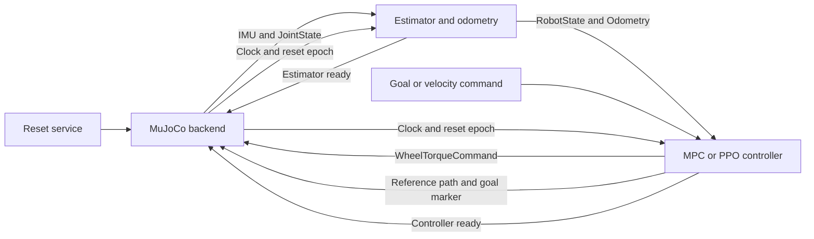
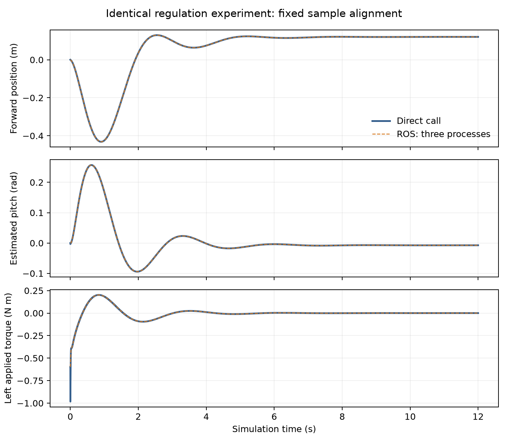

# ROS 2 Runtime

ROS 2 connects the simulator, estimator and controller as separate processes. The nodes translate messages and coordinate timing. Estimation, planning, MPC and neural inference run in the same C++ classes used by the direct-call executables.

## Node graph



`robot_msgs` defines the estimated-state and wheel-torque messages. `robot_ros` contains the node adapters and launch files. One selected controller publishes wheel commands in each launch.

The MPC and trajectory-conditioned PPO branches use the shared known-map planner and timed reference. The goal-conditioned PPO launch uses estimated state and a position goal. Each policy has its own observation builder and actor file.

## Simulation timing

Each node uses a single-threaded executor. The backend publishes a sensor sample and waits for the estimated state with the same timestamp. On even physics steps it also waits for the corresponding torque command. It then advances physics by 1 ms. The intervening step holds the previous torque.

This produces 1000 Hz physics and estimation with 500 Hz control in simulation time. Wall-clock execution speed depends on computation and middleware latency. Backend polling wakes the coordination loop. Measurement timestamps determine the simulation cadence.

The backend records wall intervals from sensor publication to state receipt, command receipt and command application using a monotonic clock. These intervals include message delivery and callback scheduling. Controller-only timings are reported in the [controller comparison](CONTROLLER_COMPARISON.md#computation).

## Sensors and estimated state

IMU and wheel encoders arrive on separate topics. Both carry simulation measurement timestamps. The IMU provides angular velocity and specific acceleration. Its orientation covariance begins with −1 to indicate that orientation is unavailable.

Both streams default to 1000 Hz. `encoder_stride` allows a lower encoder rate. For each IMU timestamp, the estimator waits for the encoder sample expected at that stride and checks its age against `sensor_timeout`. At stride one the timestamps match exactly. At stride two the encoder reading is held across two IMU updates.

The wrapper calls `StateEstimator::update()` and `PlanarOdometry::update()` once per accepted IMU sample. It publishes `/robot_state` and `/odom` with matching timestamps. The controller pairs these messages before computing a command. Invalid wheel names, dimensions and non-finite values are rejected.

## Topics

| Topic | Type | Contents |
|---|---|---|
| `/imu` | `sensor_msgs/Imu` | Angular velocity in rad/s and specific acceleration in m/s² |
| `/joint_states` | `sensor_msgs/JointState` | Named left/right wheel positions in rad and velocities in rad/s |
| `/robot_state` | `robot_msgs/RobotState` | Estimated longitudinal motion, pitch, yaw, rates and wheel state |
| `/odom` | `nav_msgs/Odometry` | Estimated planar pose in `odom`, body-forward velocity and yaw rate |
| `/wheel_torque` | `robot_msgs/WheelTorqueCommand` | Left/right N·m, generation time, source-state time, reset epoch and validity |
| `/clock` | `rosgraph_msgs/Clock` | Cumulative simulation time |
| `/episode_start_ns` | `std_msgs/UInt64` | Current reset epoch |
| `/estimator_ready`, `/controller_ready` | `std_msgs/UInt64` | Reset acknowledgments |
| `/goal_pose` | `geometry_msgs/PoseStamped` | Position goal in `odom` |
| `/cmd_vel` | `geometry_msgs/Twist` | `linear.x` and `angular.z` in velocity mode |
| `/reference_path`, `/planned_path` | `nav_msgs/Path` | Timed reference geometry and raw planned route |
| `/active_goal` | `geometry_msgs/PoseStamped` | Goal marker |

`RobotState.header.stamp` identifies the sensor measurement. Torque `header.stamp` identifies command generation, and `state_stamp` identifies the input state. `episode_time` gives elapsed time since the latest reset.

Sensor, state and torque topics use reliable delivery with keep-last depth eight. Goal, path, epoch and readiness topics use reliable transient-local depth one where late subscribers need the current value.

## Freshness and reset

Sensor, state and command freshness limits default to 10 ms simulated time. Controller and backend wall-time watchdogs default to 0.5 s. Stale state, invalid commands, controller exceptions and expired handshakes produce zero torque. The backend clamps each wheel command to ±2 N·m. Actor-load errors stop the policy process with an error.

`/reset` accepts a reset request. The backend clears physics and commands, publishes a new epoch, and waits for both readiness acknowledgments. The estimator clears its filter, origin and odometry. The controller clears references, trajectory state and its runtime object. Physics resumes after both acknowledgments match the new epoch.

`/clock` remains monotonic across resets. A 1 ms epoch boundary separates successive episodes. Messages from previous epochs are rejected. Known-map coordinates align with the reset odometry frame.

## Launch and commands

Build from the repository root, then enter the environment.

```bash
pixi install --frozen
pixi run --frozen bash -c 'cd ros2_ws && colcon build --cmake-args -DCMAKE_BUILD_TYPE=Release'
pixi run --frozen bash
source ros2_ws/install/local_setup.bash
export ROS_DOMAIN_ID=61
```

Choose one launch for the run.

```bash
ros2 launch robot_ros simulation.launch.py mode:=known_map viewer:=true duration:=44.0
ros2 launch robot_ros trajectory_ppo.launch.py viewer:=true duration:=45.0
```

The goal-conditioned policy is available through `ros2 launch robot_ros ppo.launch.py`. Obstacle-free MPC accepts `mode:=goal`, and manual velocity control accepts `mode:=velocity`. Velocity commands expire after 0.5 simulated seconds.

From another sourced terminal on the same ROS domain,

```bash
ros2 topic list -t
ros2 node list
ros2 topic echo /robot_state --once
ros2 service call /reset std_srvs/srv/Trigger '{}'
ros2 service call /simulation/pause std_srvs/srv/SetBool '{data: true}'
ros2 service call /simulation/pause std_srvs/srv/SetBool '{data: false}'
ros2 topic pub --once /goal_pose geometry_msgs/msg/PoseStamped \
  '{header: {frame_id: odom}, pose: {position: {x: 0.4, y: 0.1}, orientation: {w: 1.0}}}'
ros2 bag record --use-sim-time -o artifacts/ros2/session_bag --topics \
  /imu /joint_states /robot_state /odom /wheel_torque /goal_pose /clock /episode_start_ns
```

Start recording before sending one-shot commands and allow topic discovery and clock initialization. `ros2 topic hz` reports wall delivery rate. Consecutive measurement timestamps show the simulation sampling interval.

## Integration measurements

The regulation experiment compares separate ROS processes with direct calls for 12 simulated seconds, using the same 0.1 m reference and original tilted startup. The comparison includes all six low-level state quantities and requested/applied wheel torques. The tolerance is 1e-5 per field.

<!-- ROS_RESULTS_BEGIN -->

| Distributed experiment | Measured result |
|---|---|
| MPC regulation, 12 s | 12000 states, 6000 commands; no fallback |
| Direct/ROS maximum position difference | 1.143e-13 m |
| Direct/ROS maximum pitch difference | 2.414e-13 rad |
| Direct/ROS maximum requested torque difference | 1.376e-10 N·m |
| PPO presentation goals | 4/4 settled; fourth success at 34.648 s |
| PPO peak estimated pitch / applied torque | 0.026646 rad / 0.607607 N·m |
| Known-map estimated / true final error at 44 s | 0.022636 / 0.020560 m |
| Known-map trajectory duration / post-recovery peak pitch | 34.366586 s / 0.019087 rad |
| Known-map obstacle contact samples | 0 |
| 1000 Hz IMU / 500 Hz encoder trial, 2 s | 2000 IMU, 1000 encoder, 1000 commands |
| ROS PPO torque parity, 3 vectors | max error 3.381e-08 N·m |
| Frozen file comparison | 95 files checked; zero changes |

| Backend-observed wall pipeline interval | Mean (µs) | p95 (µs) | Maximum (µs) |
|---|---:|---:|---:|
| Sensor publication → state receipt | 6843.5 | 12161.8 | 18229.7 |
| Sensor publication → command receipt (control steps) | 13715.8 | 18501.5 | 30211.4 |
| Sensor publication → application (all physics steps) | 10447.2 | 18557.7 | 30398.5 |

The regulation run has zero simulated state age and 0–1 ms command age. Wall intervals include DDS delivery, callback scheduling and processing. Command receipt has one sample per 500 Hz update; application includes held-command steps at 1000 Hz. The measured intervals describe this lockstep execution.

<!-- ROS_RESULTS_END -->



The table's PPO goal sequence uses the six-input goal-conditioned actor. The selected trajectory-conditioned actor was also tested through ROS for 36 simulated seconds. It produced 36,000 states and 18,000 valid commands with zero obstacle contacts. The maximum shared-interval state/torque difference from direct execution was 1.1011e-11. [Final validation](final_validation.json)

Fault tests cover missing sensor samples, different encoder rates, reversed wheel-name order, non-finite inputs, stale commands, stopped clocks, actor-load failure, reset and controller loss. [Integration measurements](ros2_integration_results.json) · [Integration checks](ros2_validation.json)

## Operating conditions

The tested environment is Apple Silicon macOS, ROS 2 Jazzy through Pixi/RoboStack and MuJoCo 3.12.0. Simulation uses a lockstep handshake, so a slow controller slows wall-clock progress. Timing on distributed hosts and hardware deadlines require separate evaluation.

Odometry assumes low wheel slip and integrates gyro yaw. Planning coordinates align with the reset odometry frame. RViz can inspect paths and poses in `odom`. Global localization and a full robot TF tree remain future work.
